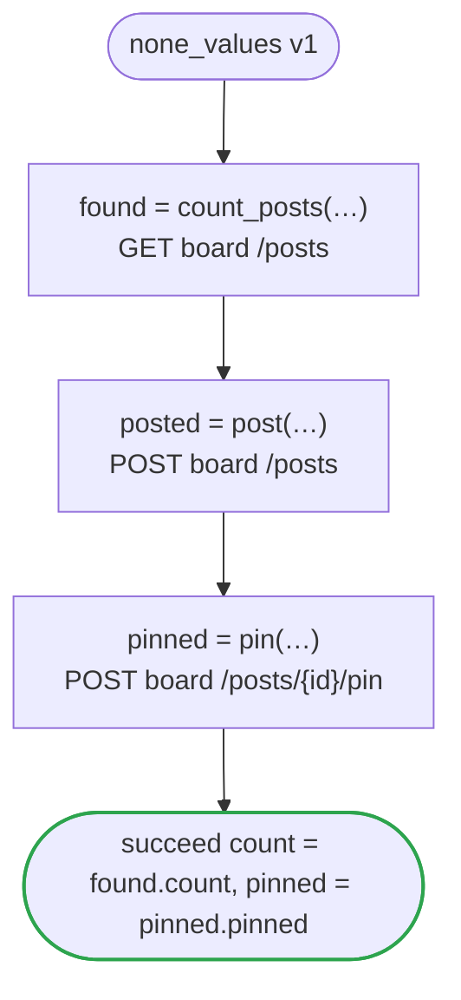

# none_values v1

Count a topic's posts up to a day, post a note on it and pin the post, where the day and the note may not be there

`tests/flows/none_values.flow` を `dandori doc` で描いたものです。入力は `topic: string`・`until: date?`・`note: string?`、出力は `count: int range >=0 <=1000`・`pinned: bool` です。

## flow

四角はタスク、両脇に線のある四角は規則、斜めの四角は外から値が届くタスク（イベントやコールバックの応答）、六角形は `match`、角の丸い四角は待ち、ステップを囲む枠はループです。破線の矢印は、呼び出しがその場で処理するエラーです。

## 呼び出し

| 行 | 呼び出し | 呼ぶもの | リトライ | タイムアウト | 失敗したとき |
|---:|---|---|---|---|---|
| 46 | `found = count_posts(…)` | `GET board /posts`・`idempotent` | — | — | `timeout`・`failure` → ワークフローが失敗する |
| 47 | `posted = post(…)` | `POST board /posts` | — | — | `timeout`・`failure` → ワークフローが失敗する |
| 48 | `pinned = pin(…)` | `POST board /posts/{id}/pin` | — | — | `timeout`・`failure` → ワークフローが失敗する |

## 終わり方

ワークフローの終わり方のすべてです。

| 行 | 終わり方 |
|---:|---|
| 49 | `succeed count = found.count, pinned = pinned.pinned` |

