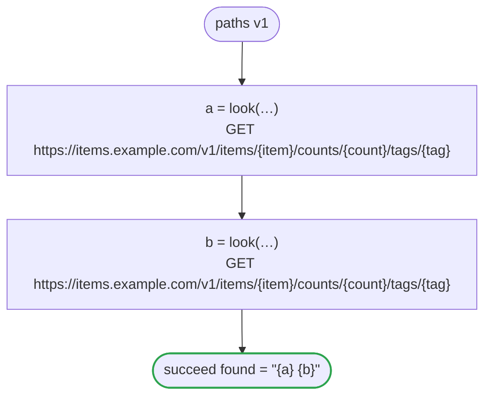

# paths v1

The arguments an HTTP task puts into its URL: a `/`, `?`, `#`, `%`, a space or text that is not ASCII stays inside its segment, from a literal, a string with values in it, a number and an optional value

`tests/flows/paths.flow`, drawn by `dandori doc`. Inputs: `item: string`, `count: int`, `tag: string?`. Outputs: `found: string`.

## flow

A rectangle is a task, one with a line down each side a rule, a slanted one a task whose value comes from outside (an event, or the answer to a callback), a hexagon a `match`, a rounded box a wait, and a box around steps a loop. A dashed arrow is an error the call handles.

## Calls

| Line | Call | Calls | Retries | Timeout | When it fails |
|---:|---|---|---|---|---|
| 19 | `a = look(…)` | `GET https://items.example.com/v1/items/{item}/counts/{count}/tags/{tag}`, `idempotent` | — | — | `timeout`, `failure` → the workflow fails |
| 20 | `b = look(…)` | `GET https://items.example.com/v1/items/{item}/counts/{count}/tags/{tag}`, `idempotent` | — | — | `timeout`, `failure` → the workflow fails |

## Ends

Every way the workflow can end.

| Line | End |
|---:|---|
| 21 | `succeed found = "{a} {b}"` |

