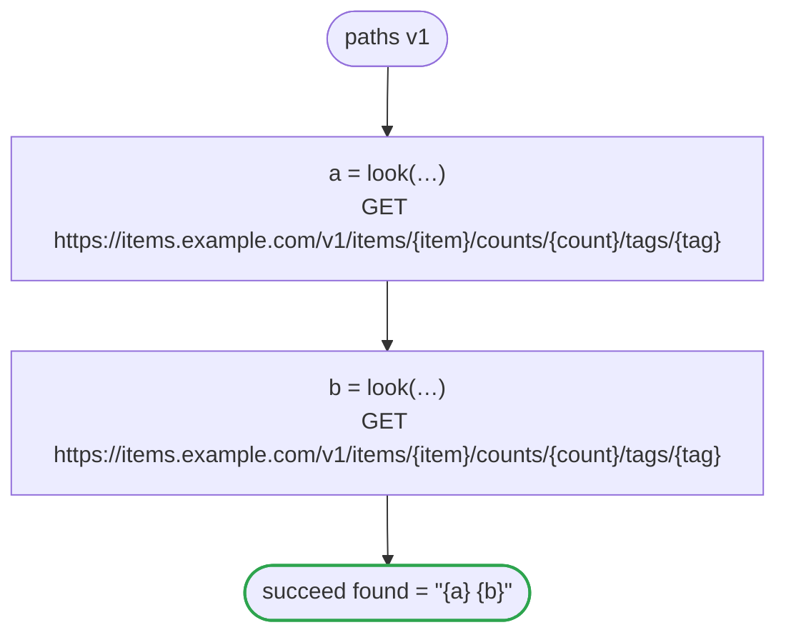

# paths v1

The arguments an HTTP task puts into its URL: a `/`, `?`, `#`, `%`, a space or text that is not ASCII stays inside its segment, from a literal, a string with values in it, a number and an optional value

`tests/flows/paths.flow` を `dandori doc` で描いたものです。入力は `item: string`・`count: int`・`tag: string?`、出力は `found: string` です。

## flow

四角はタスク、両脇に線のある四角は規則、斜めの四角は外から値が届くタスク（イベントやコールバックの応答）、六角形は `match`、角の丸い四角は待ち、ステップを囲む枠はループです。破線の矢印は、呼び出しがその場で処理するエラーです。

## 呼び出し

| 行 | 呼び出し | 呼ぶもの | リトライ | タイムアウト | 失敗したとき |
|---:|---|---|---|---|---|
| 19 | `a = look(…)` | `GET https://items.example.com/v1/items/{item}/counts/{count}/tags/{tag}`・`idempotent` | — | — | `timeout`・`failure` → ワークフローが失敗する |
| 20 | `b = look(…)` | `GET https://items.example.com/v1/items/{item}/counts/{count}/tags/{tag}`・`idempotent` | — | — | `timeout`・`failure` → ワークフローが失敗する |

## 終わり方

ワークフローの終わり方のすべてです。

| 行 | 終わり方 |
|---:|---|
| 21 | `succeed found = "{a} {b}"` |

