# 普通の名前 v1

生成するコードが自分のものにしない名前です。Go のパッケージが持ちそうな名詞と、コードが読まない Python の組み込みと JavaScript のグローバルを、型と変数に使います。どのプラットフォームでも動きます

`tests/flows/plain_names.ja.flow` を `dandori doc` で描いたものです。入力は `番号: string`、出力は `文: string`・`全部の値: 全部` です。

## flow

```mermaid
flowchart TD
    start(["普通の名前 v1"])
    s1["全部の値 = 集める(…)<br>lambda gather"]
    s2["bytes = 書く(…)<br>lambda note"]
    s3["callable = 書く(…)<br>lambda note"]
    s4["format = 書く(…)<br>lambda note"]
    s5["frozenset = 書く(…)<br>lambda note"]
    s6["hasattr = 書く(…)<br>lambda note"]
    s7["hash = 書く(…)<br>lambda note"]
    s8["iter = 書く(…)<br>lambda note"]
    s9["object = 書く(…)<br>lambda note"]
    s10["open = 書く(…)<br>lambda note"]
    s11["print = 書く(…)<br>lambda note"]
    s12["repr = 書く(…)<br>lambda note"]
    s13["reversed = 書く(…)<br>lambda note"]
    s14["setattr = 書く(…)<br>lambda note"]
    s15["slice = 書く(…)<br>lambda note"]
    s16["sum = 書く(…)<br>lambda note"]
    s17["vars = 書く(…)<br>lambda note"]
    s18(["succeed 文 = #quot;{bytes}{callable}{format}{frozenset}{hasat…"])
    start --> s1
    s1 --> s2
    s2 --> s3
    s3 --> s4
    s4 --> s5
    s5 --> s6
    s6 --> s7
    s7 --> s8
    s8 --> s9
    s9 --> s10
    s10 --> s11
    s11 --> s12
    s12 --> s13
    s13 --> s14
    s14 --> s15
    s15 --> s16
    s16 --> s17
    s17 --> s18
    classDef ok stroke:#2da44e,stroke-width:2px
    classDef bad stroke:#cf222e,stroke-width:2px
    class s18 ok
```

四角はタスク、両脇に線のある四角は規則、斜めの四角は外から値が届くタスク（イベントやコールバックの応答）、六角形は `match`、角の丸い四角は待ち、ステップを囲む枠はループです。破線の矢印は、呼び出しがその場で処理するエラーです。

## 呼び出し

| 行 | 呼び出し | 呼ぶもの | リトライ | タイムアウト | 失敗したとき |
|---:|---|---|---|---|---|
| 114 | `全部の値 = 集める(…)` | `lambda gather`・`idempotent` | — | — | `timeout`・`failure` → ワークフローが失敗する |
| 115 | `bytes = 書く(…)` | `lambda note`・`idempotent` | — | — | `timeout`・`failure` → ワークフローが失敗する |
| 116 | `callable = 書く(…)` | `lambda note`・`idempotent` | — | — | `timeout`・`failure` → ワークフローが失敗する |
| 117 | `format = 書く(…)` | `lambda note`・`idempotent` | — | — | `timeout`・`failure` → ワークフローが失敗する |
| 118 | `frozenset = 書く(…)` | `lambda note`・`idempotent` | — | — | `timeout`・`failure` → ワークフローが失敗する |
| 119 | `hasattr = 書く(…)` | `lambda note`・`idempotent` | — | — | `timeout`・`failure` → ワークフローが失敗する |
| 120 | `hash = 書く(…)` | `lambda note`・`idempotent` | — | — | `timeout`・`failure` → ワークフローが失敗する |
| 121 | `iter = 書く(…)` | `lambda note`・`idempotent` | — | — | `timeout`・`failure` → ワークフローが失敗する |
| 122 | `object = 書く(…)` | `lambda note`・`idempotent` | — | — | `timeout`・`failure` → ワークフローが失敗する |
| 123 | `open = 書く(…)` | `lambda note`・`idempotent` | — | — | `timeout`・`failure` → ワークフローが失敗する |
| 124 | `print = 書く(…)` | `lambda note`・`idempotent` | — | — | `timeout`・`failure` → ワークフローが失敗する |
| 125 | `repr = 書く(…)` | `lambda note`・`idempotent` | — | — | `timeout`・`failure` → ワークフローが失敗する |
| 126 | `reversed = 書く(…)` | `lambda note`・`idempotent` | — | — | `timeout`・`failure` → ワークフローが失敗する |
| 127 | `setattr = 書く(…)` | `lambda note`・`idempotent` | — | — | `timeout`・`failure` → ワークフローが失敗する |
| 128 | `slice = 書く(…)` | `lambda note`・`idempotent` | — | — | `timeout`・`failure` → ワークフローが失敗する |
| 129 | `sum = 書く(…)` | `lambda note`・`idempotent` | — | — | `timeout`・`failure` → ワークフローが失敗する |
| 130 | `vars = 書く(…)` | `lambda note`・`idempotent` | — | — | `timeout`・`failure` → ワークフローが失敗する |

## 終わり方

ワークフローの終わり方のすべてです。

| 行 | 終わり方 |
|---:|---|
| 131 | `succeed 文 = "{bytes}{callable}{format}{frozenset}{hasattr}{hash}{iter}{object}{open}{print}{repr}{reversed}{setattr}{slice}{sum}{vars}", 全部の値 = 全部の値` |

