# plain_names v1

Names the generated code has no claim on, though they read like its own: the nouns a Go package might have, and the builtins of Python and the globals of JavaScript the code never reads, as types and variables. Runs on every platform

`tests/flows/plain_names.flow`, drawn by `dandori doc`. Inputs: `id: string`. Outputs: `text: string`, `everything: Everything`.

## flow

```mermaid
flowchart TD
    start(["plain_names v1"])
    s1["everything = gather(…)<br>lambda gather"]
    s2["bytes = note(…)<br>lambda note"]
    s3["callable = note(…)<br>lambda note"]
    s4["format = note(…)<br>lambda note"]
    s5["frozenset = note(…)<br>lambda note"]
    s6["hasattr = note(…)<br>lambda note"]
    s7["hash = note(…)<br>lambda note"]
    s8["iter = note(…)<br>lambda note"]
    s9["object = note(…)<br>lambda note"]
    s10["open = note(…)<br>lambda note"]
    s11["print = note(…)<br>lambda note"]
    s12["repr = note(…)<br>lambda note"]
    s13["reversed = note(…)<br>lambda note"]
    s14["setattr = note(…)<br>lambda note"]
    s15["slice = note(…)<br>lambda note"]
    s16["sum = note(…)<br>lambda note"]
    s17["vars = note(…)<br>lambda note"]
    s18(["succeed text = #quot;{bytes}{callable}{format}{frozenset}{ha…"])
    start --> s1
    s1 --> s2
    s2 --> s3
    s3 --> s4
    s4 --> s5
    s5 --> s6
    s6 --> s7
    s7 --> s8
    s8 --> s9
    s9 --> s10
    s10 --> s11
    s11 --> s12
    s12 --> s13
    s13 --> s14
    s14 --> s15
    s15 --> s16
    s16 --> s17
    s17 --> s18
    classDef ok stroke:#2da44e,stroke-width:2px
    classDef bad stroke:#cf222e,stroke-width:2px
    class s18 ok
```

A rectangle is a task, one with a line down each side a rule, a slanted one a task whose value comes from outside (an event, or the answer to a callback), a hexagon a `match`, a rounded box a wait, and a box around steps a loop. A dashed arrow is an error the call handles.

## Calls

| Line | Call | Calls | Retries | Timeout | When it fails |
|---:|---|---|---|---|---|
| 114 | `everything = gather(…)` | `lambda gather`, `idempotent` | — | — | `timeout`, `failure` → the workflow fails |
| 115 | `bytes = note(…)` | `lambda note`, `idempotent` | — | — | `timeout`, `failure` → the workflow fails |
| 116 | `callable = note(…)` | `lambda note`, `idempotent` | — | — | `timeout`, `failure` → the workflow fails |
| 117 | `format = note(…)` | `lambda note`, `idempotent` | — | — | `timeout`, `failure` → the workflow fails |
| 118 | `frozenset = note(…)` | `lambda note`, `idempotent` | — | — | `timeout`, `failure` → the workflow fails |
| 119 | `hasattr = note(…)` | `lambda note`, `idempotent` | — | — | `timeout`, `failure` → the workflow fails |
| 120 | `hash = note(…)` | `lambda note`, `idempotent` | — | — | `timeout`, `failure` → the workflow fails |
| 121 | `iter = note(…)` | `lambda note`, `idempotent` | — | — | `timeout`, `failure` → the workflow fails |
| 122 | `object = note(…)` | `lambda note`, `idempotent` | — | — | `timeout`, `failure` → the workflow fails |
| 123 | `open = note(…)` | `lambda note`, `idempotent` | — | — | `timeout`, `failure` → the workflow fails |
| 124 | `print = note(…)` | `lambda note`, `idempotent` | — | — | `timeout`, `failure` → the workflow fails |
| 125 | `repr = note(…)` | `lambda note`, `idempotent` | — | — | `timeout`, `failure` → the workflow fails |
| 126 | `reversed = note(…)` | `lambda note`, `idempotent` | — | — | `timeout`, `failure` → the workflow fails |
| 127 | `setattr = note(…)` | `lambda note`, `idempotent` | — | — | `timeout`, `failure` → the workflow fails |
| 128 | `slice = note(…)` | `lambda note`, `idempotent` | — | — | `timeout`, `failure` → the workflow fails |
| 129 | `sum = note(…)` | `lambda note`, `idempotent` | — | — | `timeout`, `failure` → the workflow fails |
| 130 | `vars = note(…)` | `lambda note`, `idempotent` | — | — | `timeout`, `failure` → the workflow fails |

## Ends

Every way the workflow can end.

| Line | End |
|---:|---|
| 131 | `succeed text = "{bytes}{callable}{format}{frozenset}{hasattr}{hash}{iter}{object}{open}{print}{repr}{reversed}{setattr}{slice}{sum}{vars}", everything = everything` |

