# 普通のタスク v1

コードが読まない Python の組み込みと同じ名前の、自分で実装するタスクです。それぞれ同じ名前の変数に受けます。

`tests/flows/plain_tasks.ja.flow`, drawn by `dandori doc`. Inputs: `番号: string`. Outputs: `文: string`.

## flow

```mermaid
flowchart TD
    start(["普通のタスク v1"])
    s1["bytes = bytes(…)<br>a task you write"]
    s2["callable = callable(…)<br>a task you write"]
    s3["filter = filter(…)<br>a task you write"]
    s4["format = format(…)<br>a task you write"]
    s5["frozenset = frozenset(…)<br>a task you write"]
    s6["hasattr = hasattr(…)<br>a task you write"]
    s7["hash = hash(…)<br>a task you write"]
    s8["iter = iter(…)<br>a task you write"]
    s9["map = map(…)<br>a task you write"]
    s10["object = object(…)<br>a task you write"]
    s11["open = open(…)<br>a task you write"]
    s12["print = print(…)<br>a task you write"]
    s13["repr = repr(…)<br>a task you write"]
    s14["reversed = reversed(…)<br>a task you write"]
    s15["setattr = setattr(…)<br>a task you write"]
    s16["slice = slice(…)<br>a task you write"]
    s17["sum = sum(…)<br>a task you write"]
    s18["vars = vars(…)<br>a task you write"]
    s19(["succeed 文 = #quot;{bytes}{callable}{filter}{format}{frozense…"])
    start --> s1
    s1 --> s2
    s2 --> s3
    s3 --> s4
    s4 --> s5
    s5 --> s6
    s6 --> s7
    s7 --> s8
    s8 --> s9
    s9 --> s10
    s10 --> s11
    s11 --> s12
    s12 --> s13
    s13 --> s14
    s14 --> s15
    s15 --> s16
    s16 --> s17
    s17 --> s18
    s18 --> s19
    classDef ok stroke:#2da44e,stroke-width:2px
    classDef bad stroke:#cf222e,stroke-width:2px
    class s19 ok
```

A rectangle is a task, one with a line down each side a rule, a slanted one a task whose value comes from outside (an event, or the answer to a callback), a hexagon a `match`, a rounded box a wait, and a box around steps a loop. A dashed arrow is an error the call handles.

## Calls

| Line | Call | Calls | Retries | Timeout | When it fails |
|---:|---|---|---|---|---|
| 30 | `bytes = bytes(…)` | a task you write | — | — | `timeout`, `failure` → the workflow fails |
| 31 | `callable = callable(…)` | a task you write | — | — | `timeout`, `failure` → the workflow fails |
| 32 | `filter = filter(…)` | a task you write | — | — | `timeout`, `failure` → the workflow fails |
| 33 | `format = format(…)` | a task you write | — | — | `timeout`, `failure` → the workflow fails |
| 34 | `frozenset = frozenset(…)` | a task you write | — | — | `timeout`, `failure` → the workflow fails |
| 35 | `hasattr = hasattr(…)` | a task you write | — | — | `timeout`, `failure` → the workflow fails |
| 36 | `hash = hash(…)` | a task you write | — | — | `timeout`, `failure` → the workflow fails |
| 37 | `iter = iter(…)` | a task you write | — | — | `timeout`, `failure` → the workflow fails |
| 38 | `map = map(…)` | a task you write | — | — | `timeout`, `failure` → the workflow fails |
| 39 | `object = object(…)` | a task you write | — | — | `timeout`, `failure` → the workflow fails |
| 40 | `open = open(…)` | a task you write | — | — | `timeout`, `failure` → the workflow fails |
| 41 | `print = print(…)` | a task you write | — | — | `timeout`, `failure` → the workflow fails |
| 42 | `repr = repr(…)` | a task you write | — | — | `timeout`, `failure` → the workflow fails |
| 43 | `reversed = reversed(…)` | a task you write | — | — | `timeout`, `failure` → the workflow fails |
| 44 | `setattr = setattr(…)` | a task you write | — | — | `timeout`, `failure` → the workflow fails |
| 45 | `slice = slice(…)` | a task you write | — | — | `timeout`, `failure` → the workflow fails |
| 46 | `sum = sum(…)` | a task you write | — | — | `timeout`, `failure` → the workflow fails |
| 47 | `vars = vars(…)` | a task you write | — | — | `timeout`, `failure` → the workflow fails |

## Ends

Every way the workflow can end.

| Line | End |
|---:|---|
| 48 | `succeed 文 = "{bytes}{callable}{filter}{format}{frozenset}{hasattr}{hash}{iter}{map}{object}{open}{print}{repr}{reversed}{setattr}{slice}{sum}{vars}"` |

