# plain_tasks v1

Tasks you implement named as the builtins of Python the code never reads, each read into a variable of its name.

`tests/flows/plain_tasks.flow` を `dandori doc` で描いたものです。入力は `id: string`、出力は `text: string` です。

## flow

```mermaid
flowchart TD
    start(["plain_tasks v1"])
    s1["bytes = bytes(…)<br>自分で書くタスク"]
    s2["callable = callable(…)<br>自分で書くタスク"]
    s3["filter = filter(…)<br>自分で書くタスク"]
    s4["format = format(…)<br>自分で書くタスク"]
    s5["frozenset = frozenset(…)<br>自分で書くタスク"]
    s6["hasattr = hasattr(…)<br>自分で書くタスク"]
    s7["hash = hash(…)<br>自分で書くタスク"]
    s8["iter = iter(…)<br>自分で書くタスク"]
    s9["map = map(…)<br>自分で書くタスク"]
    s10["object = object(…)<br>自分で書くタスク"]
    s11["open = open(…)<br>自分で書くタスク"]
    s12["print = print(…)<br>自分で書くタスク"]
    s13["repr = repr(…)<br>自分で書くタスク"]
    s14["reversed = reversed(…)<br>自分で書くタスク"]
    s15["setattr = setattr(…)<br>自分で書くタスク"]
    s16["slice = slice(…)<br>自分で書くタスク"]
    s17["sum = sum(…)<br>自分で書くタスク"]
    s18["vars = vars(…)<br>自分で書くタスク"]
    s19(["succeed text = #quot;{bytes}{callable}{filter}{format}{froze…"])
    start --> s1
    s1 --> s2
    s2 --> s3
    s3 --> s4
    s4 --> s5
    s5 --> s6
    s6 --> s7
    s7 --> s8
    s8 --> s9
    s9 --> s10
    s10 --> s11
    s11 --> s12
    s12 --> s13
    s13 --> s14
    s14 --> s15
    s15 --> s16
    s16 --> s17
    s17 --> s18
    s18 --> s19
    classDef ok stroke:#2da44e,stroke-width:2px
    classDef bad stroke:#cf222e,stroke-width:2px
    class s19 ok
```

四角はタスク、両脇に線のある四角は規則、斜めの四角は外から値が届くタスク（イベントやコールバックの応答）、六角形は `match`、角の丸い四角は待ち、ステップを囲む枠はループです。破線の矢印は、呼び出しがその場で処理するエラーです。

## 呼び出し

| 行 | 呼び出し | 呼ぶもの | リトライ | タイムアウト | 失敗したとき |
|---:|---|---|---|---|---|
| 30 | `bytes = bytes(…)` | 自分で書くタスク | — | — | `timeout`・`failure` → ワークフローが失敗する |
| 31 | `callable = callable(…)` | 自分で書くタスク | — | — | `timeout`・`failure` → ワークフローが失敗する |
| 32 | `filter = filter(…)` | 自分で書くタスク | — | — | `timeout`・`failure` → ワークフローが失敗する |
| 33 | `format = format(…)` | 自分で書くタスク | — | — | `timeout`・`failure` → ワークフローが失敗する |
| 34 | `frozenset = frozenset(…)` | 自分で書くタスク | — | — | `timeout`・`failure` → ワークフローが失敗する |
| 35 | `hasattr = hasattr(…)` | 自分で書くタスク | — | — | `timeout`・`failure` → ワークフローが失敗する |
| 36 | `hash = hash(…)` | 自分で書くタスク | — | — | `timeout`・`failure` → ワークフローが失敗する |
| 37 | `iter = iter(…)` | 自分で書くタスク | — | — | `timeout`・`failure` → ワークフローが失敗する |
| 38 | `map = map(…)` | 自分で書くタスク | — | — | `timeout`・`failure` → ワークフローが失敗する |
| 39 | `object = object(…)` | 自分で書くタスク | — | — | `timeout`・`failure` → ワークフローが失敗する |
| 40 | `open = open(…)` | 自分で書くタスク | — | — | `timeout`・`failure` → ワークフローが失敗する |
| 41 | `print = print(…)` | 自分で書くタスク | — | — | `timeout`・`failure` → ワークフローが失敗する |
| 42 | `repr = repr(…)` | 自分で書くタスク | — | — | `timeout`・`failure` → ワークフローが失敗する |
| 43 | `reversed = reversed(…)` | 自分で書くタスク | — | — | `timeout`・`failure` → ワークフローが失敗する |
| 44 | `setattr = setattr(…)` | 自分で書くタスク | — | — | `timeout`・`failure` → ワークフローが失敗する |
| 45 | `slice = slice(…)` | 自分で書くタスク | — | — | `timeout`・`failure` → ワークフローが失敗する |
| 46 | `sum = sum(…)` | 自分で書くタスク | — | — | `timeout`・`failure` → ワークフローが失敗する |
| 47 | `vars = vars(…)` | 自分で書くタスク | — | — | `timeout`・`failure` → ワークフローが失敗する |

## 終わり方

ワークフローの終わり方のすべてです。

| 行 | 終わり方 |
|---:|---|
| 48 | `succeed text = "{bytes}{callable}{filter}{format}{frozenset}{hasattr}{hash}{iter}{map}{object}{open}{print}{repr}{reversed}{setattr}{slice}{sum}{vars}"` |

