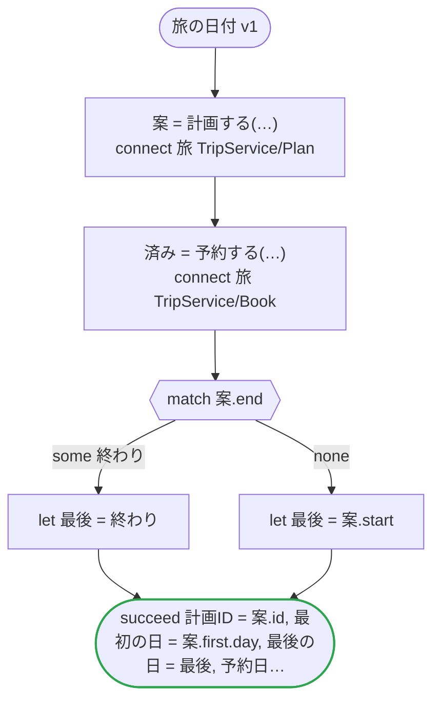

# 旅の日付 v1

日を google.type.Date で持つ Connect のサービスで、旅を計画して予約する。初日は protobuf の JSON の日付の形で送り、計画の日は date で読んで予約へ渡す

`tests/flows/proto_dates.ja.flow`, drawn by `dandori doc`. Inputs: `旅行者: string`, `初日: date`. Outputs: `計画ID: string`, `最初の日: date`, `最後の日: date`, `予約日: date`.

## flow

A rectangle is a task, one with a line down each side a rule, a slanted one a task whose value comes from outside (an event, or the answer to a callback), a hexagon a `match`, a rounded box a wait, and a box around steps a loop. A dashed arrow is an error the call handles.

## Calls

| Line | Call | Calls | Retries | Timeout | When it fails |
|---:|---|---|---|---|---|
| 47 | `案 = 計画する(…)` | `connect 旅 TripService/Plan` | — | — | `timeout`, `failure` → the workflow fails |
| 48 | `済み = 予約する(…)` | `connect 旅 TripService/Book` | — | — | `timeout`, `failure` → the workflow fails |

## Ends

Every way the workflow can end.

| Line | End |
|---:|---|
| 52 | `succeed 計画ID = 案.id, 最初の日 = 案.first.day, 最後の日 = 最後, 予約日 = 済み.bookedOn` |

