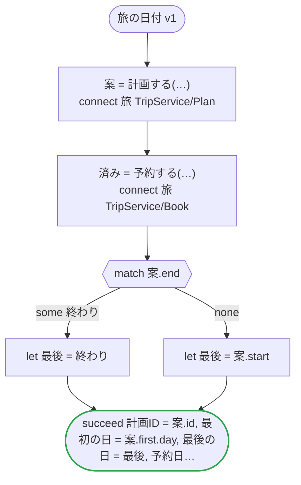

# 旅の日付 v1

日を google.type.Date で持つ Connect のサービスで、旅を計画して予約する。初日は protobuf の JSON の日付の形で送り、計画の日は date で読んで予約へ渡す

`tests/flows/proto_dates.ja.flow` を `dandori doc` で描いたものです。入力は `旅行者: string`・`初日: date`、出力は `計画ID: string`・`最初の日: date`・`最後の日: date`・`予約日: date` です。

## flow

四角はタスク、両脇に線のある四角は規則、斜めの四角は外から値が届くタスク（イベントやコールバックの応答）、六角形は `match`、角の丸い四角は待ち、ステップを囲む枠はループです。破線の矢印は、呼び出しがその場で処理するエラーです。

## 呼び出し

| 行 | 呼び出し | 呼ぶもの | リトライ | タイムアウト | 失敗したとき |
|---:|---|---|---|---|---|
| 47 | `案 = 計画する(…)` | `connect 旅 TripService/Plan` | — | — | `timeout`・`failure` → ワークフローが失敗する |
| 48 | `済み = 予約する(…)` | `connect 旅 TripService/Book` | — | — | `timeout`・`failure` → ワークフローが失敗する |

## 終わり方

ワークフローの終わり方のすべてです。

| 行 | 終わり方 |
|---:|---|
| 52 | `succeed 計画ID = 案.id, 最初の日 = 案.first.day, 最後の日 = 最後, 予約日 = 済み.bookedOn` |

