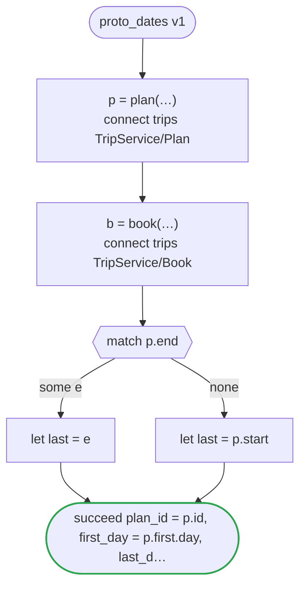

# proto_dates v1

Plan a trip at a Connect service that holds its days as google.type.Date, and book it: the first day goes out as protobuf's JSON writes a date, and the plan's days come back as dates and go on to the booking

`tests/flows/proto_dates.flow`, drawn by `dandori doc`. Inputs: `traveller: string`, `start: date`. Outputs: `plan_id: string`, `first_day: date`, `last_day: date`, `booked_on: date`.

## flow

A rectangle is a task, one with a line down each side a rule, a slanted one a task whose value comes from outside (an event, or the answer to a callback), a hexagon a `match`, a rounded box a wait, and a box around steps a loop. A dashed arrow is an error the call handles.

## Calls

| Line | Call | Calls | Retries | Timeout | When it fails |
|---:|---|---|---|---|---|
| 48 | `p = plan(…)` | `connect trips TripService/Plan` | — | — | `timeout`, `failure` → the workflow fails |
| 49 | `b = book(…)` | `connect trips TripService/Book` | — | — | `timeout`, `failure` → the workflow fails |

## Ends

Every way the workflow can end.

| Line | End |
|---:|---|
| 53 | `succeed plan_id = p.id, first_day = p.first.day, last_day = last, booked_on = b.bookedOn` |

