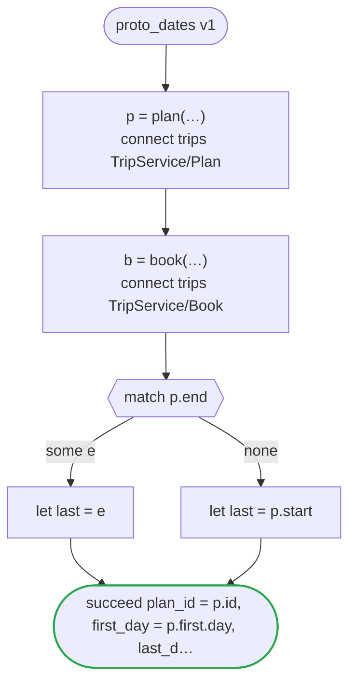

# proto_dates v1

Plan a trip at a Connect service that holds its days as google.type.Date, and book it: the first day goes out as protobuf's JSON writes a date, and the plan's days come back as dates and go on to the booking

`tests/flows/proto_dates.flow` を `dandori doc` で描いたものです。入力は `traveller: string`・`start: date`、出力は `plan_id: string`・`first_day: date`・`last_day: date`・`booked_on: date` です。

## flow

四角はタスク、両脇に線のある四角は規則、斜めの四角は外から値が届くタスク（イベントやコールバックの応答）、六角形は `match`、角の丸い四角は待ち、ステップを囲む枠はループです。破線の矢印は、呼び出しがその場で処理するエラーです。

## 呼び出し

| 行 | 呼び出し | 呼ぶもの | リトライ | タイムアウト | 失敗したとき |
|---:|---|---|---|---|---|
| 48 | `p = plan(…)` | `connect trips TripService/Plan` | — | — | `timeout`・`failure` → ワークフローが失敗する |
| 49 | `b = book(…)` | `connect trips TripService/Book` | — | — | `timeout`・`failure` → ワークフローが失敗する |

## 終わり方

ワークフローの終わり方のすべてです。

| 行 | 終わり方 |
|---:|---|
| 53 | `succeed plan_id = p.id, first_day = p.first.day, last_day = last, booked_on = b.bookedOn` |

