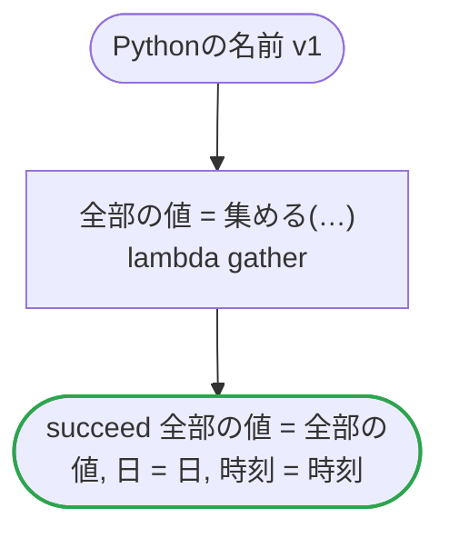

# Pythonの名前 v1

Python のコードが自分で持つ名前や、組み込みから読む名前を、型に付けたフローです。types.py が取り込む名前、自分で宣言する補助の名前、検査が呼ぶ組み込みの名前を使います。コードは自分の名前を別の名前で読み、フローはどのプラットフォームでも動きます

`tests/flows/python_names.ja.flow`, drawn by `dandori doc`. Inputs: `番号: string`, `日: date`, `時刻: timestamp`. Outputs: `全部の値: 全部`, `日: date`, `時刻: timestamp`.

## flow

A rectangle is a task, one with a line down each side a rule, a slanted one a task whose value comes from outside (an event, or the answer to a callback), a hexagon a `match`, a rounded box a wait, and a box around steps a loop. A dashed arrow is an error the call handles.

## Calls

| Line | Call | Calls | Retries | Timeout | When it fails |
|---:|---|---|---|---|---|
| 82 | `全部の値 = 集める(…)` | `lambda gather`, `idempotent` | — | — | `timeout`, `failure` → the workflow fails |

## Ends

Every way the workflow can end.

| Line | End |
|---:|---|
| 83 | `succeed 全部の値 = 全部の値, 日 = 日, 時刻 = 時刻` |

