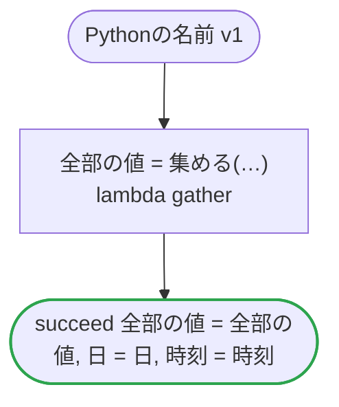

# Pythonの名前 v1

Python のコードが自分で持つ名前や、組み込みから読む名前を、型に付けたフローです。types.py が取り込む名前、自分で宣言する補助の名前、検査が呼ぶ組み込みの名前を使います。コードは自分の名前を別の名前で読み、フローはどのプラットフォームでも動きます

`tests/flows/python_names.ja.flow` を `dandori doc` で描いたものです。入力は `番号: string`・`日: date`・`時刻: timestamp`、出力は `全部の値: 全部`・`日: date`・`時刻: timestamp` です。

## flow

四角はタスク、両脇に線のある四角は規則、斜めの四角は外から値が届くタスク（イベントやコールバックの応答）、六角形は `match`、角の丸い四角は待ち、ステップを囲む枠はループです。破線の矢印は、呼び出しがその場で処理するエラーです。

## 呼び出し

| 行 | 呼び出し | 呼ぶもの | リトライ | タイムアウト | 失敗したとき |
|---:|---|---|---|---|---|
| 82 | `全部の値 = 集める(…)` | `lambda gather`・`idempotent` | — | — | `timeout`・`failure` → ワークフローが失敗する |

## 終わり方

ワークフローの終わり方のすべてです。

| 行 | 終わり方 |
|---:|---|
| 83 | `succeed 全部の値 = 全部の値, 日 = 日, 時刻 = 時刻` |

