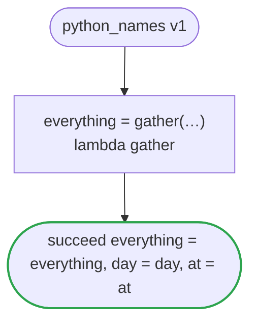

# python_names v1

Types named as what the code of Python has for itself or reads from its builtins: what types.py imports, the helpers it declares and the builtins its checks call. The code reads its own by other names, and the flow runs on every platform

`tests/flows/python_names.flow`, drawn by `dandori doc`. Inputs: `id: string`, `day: date`, `at: timestamp`. Outputs: `everything: Everything`, `day: date`, `at: timestamp`.

## flow

A rectangle is a task, one with a line down each side a rule, a slanted one a task whose value comes from outside (an event, or the answer to a callback), a hexagon a `match`, a rounded box a wait, and a box around steps a loop. A dashed arrow is an error the call handles.

## Calls

| Line | Call | Calls | Retries | Timeout | When it fails |
|---:|---|---|---|---|---|
| 82 | `everything = gather(…)` | `lambda gather`, `idempotent` | — | — | `timeout`, `failure` → the workflow fails |

## Ends

Every way the workflow can end.

| Line | End |
|---:|---|
| 83 | `succeed everything = everything, day = day, at = at` |

