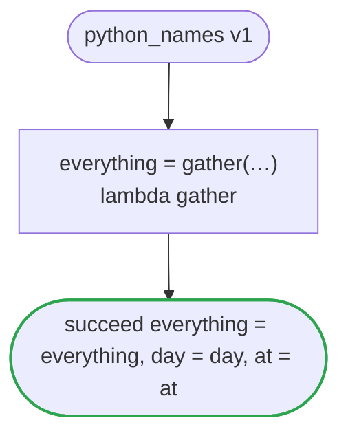

# python_names v1

Types named as what the code of Python has for itself or reads from its builtins: what types.py imports, the helpers it declares and the builtins its checks call. The code reads its own by other names, and the flow runs on every platform

`tests/flows/python_names.flow` を `dandori doc` で描いたものです。入力は `id: string`・`day: date`・`at: timestamp`、出力は `everything: Everything`・`day: date`・`at: timestamp` です。

## flow

四角はタスク、両脇に線のある四角は規則、斜めの四角は外から値が届くタスク（イベントやコールバックの応答）、六角形は `match`、角の丸い四角は待ち、ステップを囲む枠はループです。破線の矢印は、呼び出しがその場で処理するエラーです。

## 呼び出し

| 行 | 呼び出し | 呼ぶもの | リトライ | タイムアウト | 失敗したとき |
|---:|---|---|---|---|---|
| 82 | `everything = gather(…)` | `lambda gather`・`idempotent` | — | — | `timeout`・`failure` → ワークフローが失敗する |

## 終わり方

ワークフローの終わり方のすべてです。

| 行 | 終わり方 |
|---:|---|
| 83 | `succeed everything = everything, day = day, at = at` |

