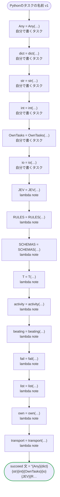

# Pythonのタスクの名前 v1

Python のコードがタスクを動かす所で読む名前を、タスクに付けたフローです。取り込む型、呼ぶ組み込み、アクティビティが自分で持つ名前を使い、それぞれ同じ名前の変数に受けます。コードは自分の名前を別の名前で読み、フローはどのプラットフォームでも動きます

`tests/flows/python_tasks.ja.flow` を `dandori doc` で描いたものです。入力は `番号: string`、出力は `文: string` です。

## flow

四角はタスク、両脇に線のある四角は規則、斜めの四角は外から値が届くタスク（イベントやコールバックの応答）、六角形は `match`、角の丸い四角は待ち、ステップを囲む枠はループです。破線の矢印は、呼び出しがその場で処理するエラーです。

## 呼び出し

| 行 | 呼び出し | 呼ぶもの | リトライ | タイムアウト | 失敗したとき |
|---:|---|---|---|---|---|
| 60 | `Any = Any(…)` | 自分で書くタスク | — | — | `timeout`・`failure` → ワークフローが失敗する |
| 61 | `dict = dict(…)` | 自分で書くタスク | — | — | `timeout`・`failure` → ワークフローが失敗する |
| 62 | `str = str(…)` | 自分で書くタスク | — | — | `timeout`・`failure` → ワークフローが失敗する |
| 63 | `int = int(…)` | 自分で書くタスク | — | — | `timeout`・`failure` → ワークフローが失敗する |
| 64 | `OwnTasks = OwnTasks(…)` | 自分で書くタスク | — | — | `timeout`・`failure` → ワークフローが失敗する |
| 65 | `io = io(…)` | 自分で書くタスク | — | — | `timeout`・`failure` → ワークフローが失敗する |
| 66 | `JEV = JEV(…)` | `lambda note`・`idempotent` | — | — | `timeout`・`failure` → ワークフローが失敗する |
| 67 | `RULES = RULES(…)` | `lambda note`・`idempotent` | — | — | `timeout`・`failure` → ワークフローが失敗する |
| 68 | `SCHEMAS = SCHEMAS(…)` | `lambda note`・`idempotent` | — | — | `timeout`・`failure` → ワークフローが失敗する |
| 69 | `T = T(…)` | `lambda note`・`idempotent` | — | — | `timeout`・`failure` → ワークフローが失敗する |
| 70 | `activity = activity(…)` | `lambda note`・`idempotent` | — | — | `timeout`・`failure` → ワークフローが失敗する |
| 71 | `beating = beating(…)` | `lambda note`・`idempotent` | — | — | `timeout`・`failure` → ワークフローが失敗する |
| 72 | `fail = fail(…)` | `lambda note`・`idempotent` | — | — | `timeout`・`failure` → ワークフローが失敗する |
| 73 | `list = list(…)` | `lambda note`・`idempotent` | — | — | `timeout`・`failure` → ワークフローが失敗する |
| 74 | `own = own(…)` | `lambda note`・`idempotent` | — | — | `timeout`・`failure` → ワークフローが失敗する |
| 75 | `transport = transport(…)` | `lambda note`・`idempotent` | — | — | `timeout`・`failure` → ワークフローが失敗する |

## 終わり方

ワークフローの終わり方のすべてです。

| 行 | 終わり方 |
|---:|---|
| 76 | `succeed 文 = "{Any}{dict}{str}{int}{OwnTasks}{io}{JEV}{RULES}{SCHEMAS}{T}{activity}{beating}{fail}{list}{own}{transport}"` |

