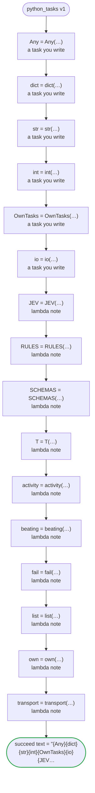

# python_tasks v1

Tasks named as what the code of Python reads where it runs them: a type it imports, the builtins it calls, and the names the activities have for themselves. Each is read into a variable of its name. The code reads its own by other names, and the flow runs on every platform

`tests/flows/python_tasks.flow`, drawn by `dandori doc`. Inputs: `id: string`. Outputs: `text: string`.

## flow

A rectangle is a task, one with a line down each side a rule, a slanted one a task whose value comes from outside (an event, or the answer to a callback), a hexagon a `match`, a rounded box a wait, and a box around steps a loop. A dashed arrow is an error the call handles.

## Calls

| Line | Call | Calls | Retries | Timeout | When it fails |
|---:|---|---|---|---|---|
| 60 | `Any = Any(…)` | a task you write | — | — | `timeout`, `failure` → the workflow fails |
| 61 | `dict = dict(…)` | a task you write | — | — | `timeout`, `failure` → the workflow fails |
| 62 | `str = str(…)` | a task you write | — | — | `timeout`, `failure` → the workflow fails |
| 63 | `int = int(…)` | a task you write | — | — | `timeout`, `failure` → the workflow fails |
| 64 | `OwnTasks = OwnTasks(…)` | a task you write | — | — | `timeout`, `failure` → the workflow fails |
| 65 | `io = io(…)` | a task you write | — | — | `timeout`, `failure` → the workflow fails |
| 66 | `JEV = JEV(…)` | `lambda note`, `idempotent` | — | — | `timeout`, `failure` → the workflow fails |
| 67 | `RULES = RULES(…)` | `lambda note`, `idempotent` | — | — | `timeout`, `failure` → the workflow fails |
| 68 | `SCHEMAS = SCHEMAS(…)` | `lambda note`, `idempotent` | — | — | `timeout`, `failure` → the workflow fails |
| 69 | `T = T(…)` | `lambda note`, `idempotent` | — | — | `timeout`, `failure` → the workflow fails |
| 70 | `activity = activity(…)` | `lambda note`, `idempotent` | — | — | `timeout`, `failure` → the workflow fails |
| 71 | `beating = beating(…)` | `lambda note`, `idempotent` | — | — | `timeout`, `failure` → the workflow fails |
| 72 | `fail = fail(…)` | `lambda note`, `idempotent` | — | — | `timeout`, `failure` → the workflow fails |
| 73 | `list = list(…)` | `lambda note`, `idempotent` | — | — | `timeout`, `failure` → the workflow fails |
| 74 | `own = own(…)` | `lambda note`, `idempotent` | — | — | `timeout`, `failure` → the workflow fails |
| 75 | `transport = transport(…)` | `lambda note`, `idempotent` | — | — | `timeout`, `failure` → the workflow fails |

## Ends

Every way the workflow can end.

| Line | End |
|---:|---|
| 76 | `succeed text = "{Any}{dict}{str}{int}{OwnTasks}{io}{JEV}{RULES}{SCHEMAS}{T}{activity}{beating}{fail}{list}{own}{transport}"` |

