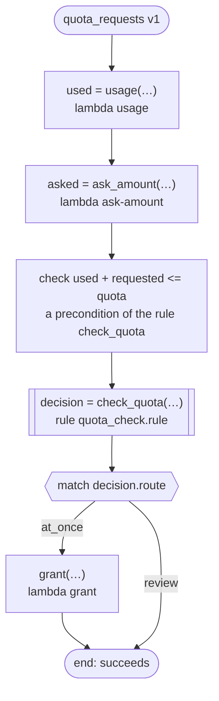

# quota_requests v1

Grants a request for part of a quota at once or sends it to review. What was used and what is asked come from tasks with no range, so ritsu cannot decide the rule's precondition that the two never come to more than the quota (a sum on one side), and the workflow checks it as soon as both are made. Runs on every platform

`tests/flows/quota.flow`, drawn by `dandori doc`. Inputs: `account: string`, `quota: int range >=1 <=1000`.

## flow



A rectangle is a task, one with a line down each side a rule, a slanted one a task whose value comes from outside (an event, or the answer to a callback), a hexagon a `match`, a rounded box a wait, and a box around steps a loop. A dashed arrow is an error the call handles.

## Calls

| Line | Call | Calls | Retries | Timeout | When it fails |
|---:|---|---|---|---|---|
| 25 | `used = usage(…)` | `lambda usage`, `idempotent` | — | — | `timeout`, `failure` → the workflow fails |
| 26 | `asked = ask_amount(…)` | `lambda ask-amount`, `idempotent` | — | — | `timeout`, `failure` → the workflow fails |
| 27 | `decision = check_quota(…)` | rule `quota_check.rule` | 2 times, after 1 second and 2 (failure) | — | `timeout`, `failure` → the workflow fails |
| 29 | `grant(…)` | `lambda grant`, `key` | — | — | `timeout`, `failure` → the workflow fails |

## Ends

Every way the workflow can end.

| Line | End |
|---:|---|
| 30 | the flow runs to its end, and the workflow succeeds |

## Rules

The rules this workflow calls, each as the page for people that `rulec doc` renders.

<details>
<summary><code>check_quota</code> · quota_check v1 · <code>rules/quota_check.rule</code></summary>

<!-- Generated by rulec 0.36.0 from quota_check.rule (sha256:2855314707e7). This is a read-only rendering; the source of truth is the .rule file. Edits cannot be carried back. -->
# Rule quota_check v1

Whether a request for part of a quota is granted at once or reviewed. What was used and what is asked never come to more than the quota, which the rule takes for granted: a precondition dandori cannot show where the two come from tasks with no range, so the workflow checks it when it runs (tests/flows/quota.flow)

## Inputs

| Name | Type | Range | Notes |
|---|---|---|---|
| used | number | 0 to 1000 |  |
| requested | number | 0 to 1000 |  |
| quota | number | 1 to 1000 |  |

## Outputs

| Name | Type | Rounding | Notes |
|---|---|---|---|
| route | path (2 values) |  |  |

## Types

An enum is a **closed** finite set. Add a value, and every table that does not look at it fails the completeness check.

- **path** (2 values) — at_once, review

## Combinations that do not happen

Relations between inputs that the caller guarantees. **The checks believed them and demanded no row for the combinations they exclude**, and the generated code refuses such an input at the door.

- `used + requested <= quota`


## Table pick (policy unique)

| Column | Source |
|---|---|
| requested | Input |
| → route | Output of this rule |

| # | requested | → route (path) |
|---|---|---|
| 1 | <=100 | at_once |
| 2 | >100 | review |

**What `rulec check` verified**

- Every combination of inputs matches some row (E101 completeness)
- There is no row that can never match (E102 unreachable row)
- No input matches two or more rows at once (E105 overlap). Reordering the rows does not change the meaning

## Examples (verified)

| used | requested | quota | → route |
|---|---|---|---|
| 400 | 100 | 1000 | at_once |
| 400 | 300 | 1000 | review |

`rulec check` ran these 2 examples through the reference evaluator, and every one produced the declared values (E107). The examples are an **executable specification**.

</details>

## What check says

What `dandori check` says of this workflow, each with the run that gets there.

```text
warning[W104]: tests/flows/quota.flow:27:1: nothing says what range `used` is in (the answer of `usage` has no range), and `used` of the rule `check_quota` takes `>=0 <=1000`
    27 |   let decision = check_quota(used: used, requested: asked, quota: quota)
warning[W104]: tests/flows/quota.flow:27:1: nothing says what range `asked` is in (the answer of `ask_amount` has no range), and `requested` of the rule `check_quota` takes `>=0 <=1000`
    27 |   let decision = check_quota(used: used, requested: asked, quota: quota)
```
