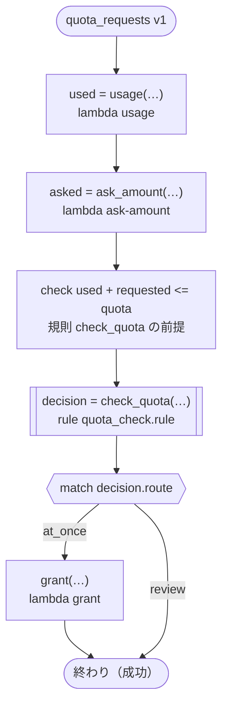

# quota_requests v1

Grants a request for part of a quota at once or sends it to review. What was used and what is asked come from tasks with no range, so ritsu cannot decide the rule's precondition that the two never come to more than the quota (a sum on one side), and the workflow checks it as soon as both are made. Runs on every platform

`tests/flows/quota.flow` を `dandori doc` で描いたものです。入力は `account: string`・`quota: int` です。

## flow



四角はタスク、両脇に線のある四角は規則、斜めの四角は外から値が届くタスク（イベントやコールバックの応答）、六角形は `match`、角の丸い四角は待ち、ステップを囲む枠はループです。破線の矢印は、呼び出しがその場で処理するエラーです。

## 呼び出し

| 行 | 呼び出し | 呼ぶもの | リトライ | タイムアウト | 失敗したとき |
|---:|---|---|---|---|---|
| 25 | `used = usage(…)` | `lambda usage`・`idempotent` | — | — | `timeout`・`failure` → ワークフローが失敗する |
| 26 | `asked = ask_amount(…)` | `lambda ask-amount`・`idempotent` | — | — | `timeout`・`failure` → ワークフローが失敗する |
| 27 | `decision = check_quota(…)` | 規則 `quota_check.rule` | 1 秒後と 2 秒後の 2 回（failure） | — | `timeout`・`failure` → ワークフローが失敗する |
| 29 | `grant(…)` | `lambda grant`・`key` | — | — | `timeout`・`failure` → ワークフローが失敗する |

## 終わり方

ワークフローの終わり方のすべてです。

| 行 | 終わり方 |
|---:|---|
| 30 | flow が最後まで走り、ワークフローは成功する |

## 規則

このワークフローが呼ぶ規則です。`rulec doc` が描いた、人が読むページをそのまま載せています。

<details>
<summary><code>check_quota</code> · quota_check v1 · <code>rules/quota_check.rule</code></summary>

<!-- rulec 0.29.1 が quota_check.rule (sha256:2855314707e7) から生成した資料です。読むためのもので、もとになるのは .rule のほうです。ここを編集しても .rule には戻せません。 -->
# 規則 quota_check v1

Whether a request for part of a quota is granted at once or reviewed. What was used and what is asked never come to more than the quota, which the rule takes for granted: a precondition dandori cannot show where the two come from tasks with no range, so the workflow checks it when it runs (tests/flows/quota.flow)

## 入力

| 名前 | 型 | 範囲 | 注記 |
|---|---|---|---|
| used | number | 0 〜 1000 |  |
| requested | number | 0 〜 1000 |  |
| quota | number | 1 〜 1000 |  |

## 出力

| 名前 | 型 | 丸め | 注記 |
|---|---|---|---|
| route | path（2 値） |  |  |

## 型

列挙は**閉じた**有限集合です。値を足すと、その値を扱っていない表は完全性の検査を通らなくなります。

- **path**（2 値）— at_once、review

## 起きない組み合わせ

呼び出し側が保証する、入力どうしの関係です。**検査はこれを信じて、満たさない組み合わせには行を要求していません。** 生成コードは、満たさない入力を入口で受け付けません。

- `used + requested <= quota`


## 表 pick（policy unique）

| 列 | 出どころ |
|---|---|
| requested | 入力 |
| → route | この規則の出力 |

| # | requested | → route（path） |
|---|---|---|
| 1 | <=100 | at_once |
| 2 | >100 | review |

**`rulec check` が確かめたこと**

- どの入力の組合せも、いずれかの行に当てはまります（E101 完全性）
- どの入力にも当てはまらない行はありません（E102）
- 二つ以上の行に同時に当てはまる入力はありません（E105 重なり）。行の並べ替えは意味を変えません

## 例（検証済み）

| used | requested | quota | → route |
|---|---|---|---|
| 400 | 100 | 1000 | at_once |
| 400 | 300 | 1000 | review |

この 2 件は `rulec check` が参照評価器で実行し、すべて宣言どおりの値になりました（E107）。例は**実行される仕様**です。

</details>

## 検査の結果

`dandori check` の結果です。それぞれにそうなる例が付いています。

```text
警告[W104]: tests/flows/quota.flow:27:1: `used` の範囲が分かりません（`usage` の結果に範囲がありません）。規則 `check_quota` の `used` が受け取るのは `>=0 <=1000` です
    27 |   let decision = check_quota(used: used, requested: asked, quota: quota)
警告[W104]: tests/flows/quota.flow:27:1: `asked` の範囲が分かりません（`ask_amount` の結果に範囲がありません）。規則 `check_quota` の `requested` が受け取るのは `>=0 <=1000` です
    27 |   let decision = check_quota(used: used, requested: asked, quota: quota)
```
