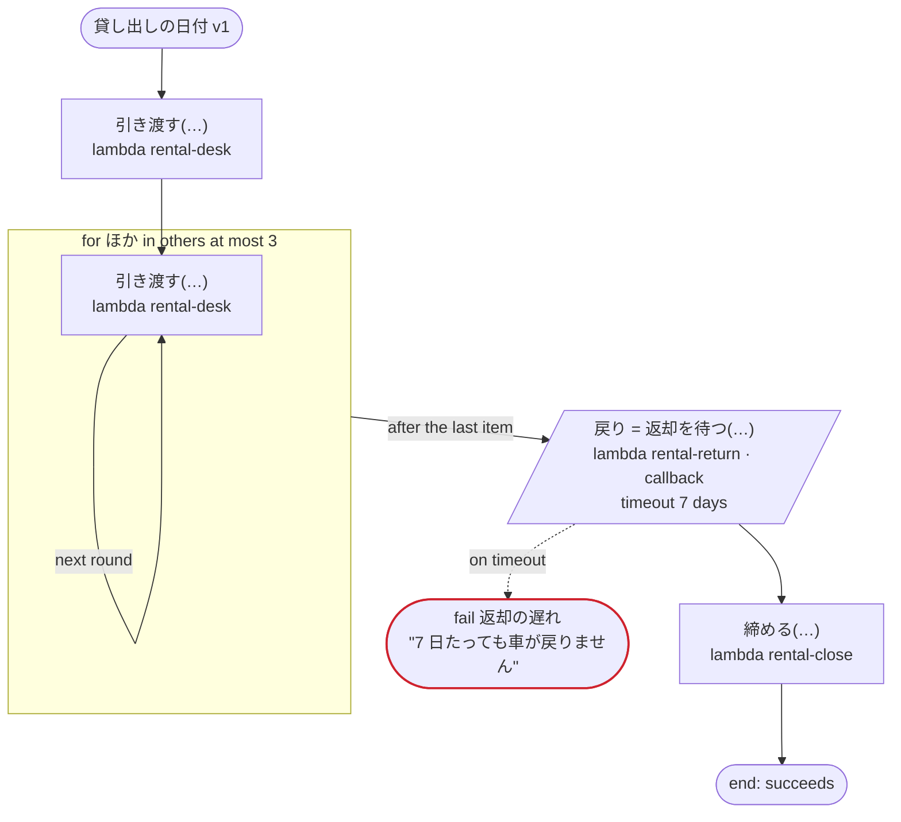

# 貸し出しの日付 v1

日を google.type.Date で持つサービスで車を貸す。貸し出しの日と運転者の免許の日を date で読んで窓口に渡し、車が戻った日を窓口が答えるのを待つ

`tests/flows/service_dates.ja.flow`, drawn by `dandori doc`. Inputs: `car: string`, `pickup: date`, `dropoff: date`, `closed: list[date]`, `driver: 運転者`, `others: list[運転者]`. It implements `rentals.v1.RentalServiceJa` (`protos/rentals.proto`).

## flow

A rectangle is a task, one with a line down each side a rule, a slanted one a task whose value comes from outside (an event, or the answer to a callback), a hexagon a `match`, a rounded box a wait, and a box around steps a loop. A dashed arrow is an error the call handles.

## Service

What each method of the service does to a run.

| Method | What it does | Task |
|---|---|---|
| `Rent` | starts a run; it can fail with `返却の遅れ` | — |
| `AnswerReturn` | answers the callback | `返却を待つ` |

## Calls

| Line | Call | Calls | Retries | Timeout | When it fails |
|---:|---|---|---|---|---|
| 43 | `引き渡す(…)` | `lambda rental-desk`, `idempotent` | — | — | `timeout`, `failure` → the workflow fails |
| 45 | `引き渡す(…)` | `lambda rental-desk`, `idempotent` | — | — | `timeout`, `failure` → the workflow fails |
| 46 | `戻り = 返却を待つ(…)` | `lambda rental-return · callback` | — | 1 minute to hand the id on, then 7 days | `timeout` → line 47 `failure` → the workflow fails |
| 48 | `締める(…)` | `lambda rental-close`, `idempotent` | — | — | `timeout`, `failure` → the workflow fails |

## Ends

Every way the workflow can end.

| Line | End |
|---:|---|
| 47 | `fail 返却の遅れ` "7 日たっても車が戻りません" |
| 48 | the flow runs to its end, and the workflow succeeds |

