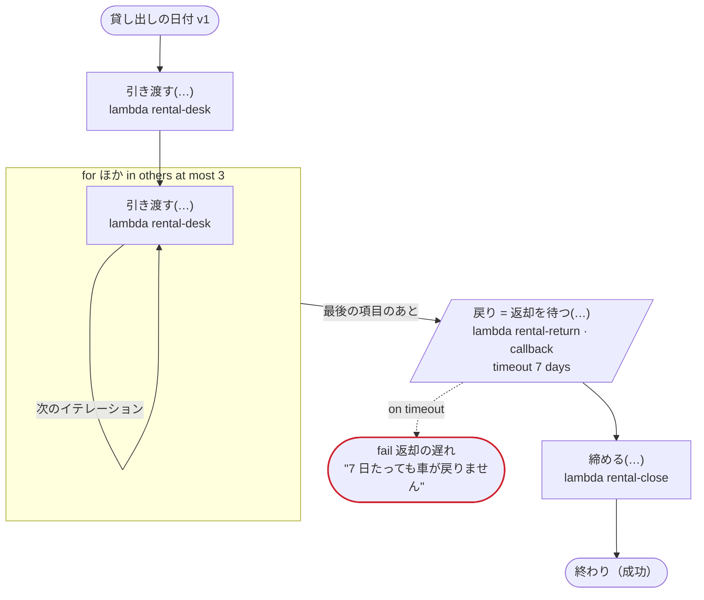

# 貸し出しの日付 v1

日を google.type.Date で持つサービスで車を貸す。貸し出しの日と運転者の免許の日を date で読んで窓口に渡し、車が戻った日を窓口が答えるのを待つ

`tests/flows/service_dates.ja.flow` を `dandori doc` で描いたものです。入力は `car: string`・`pickup: date`・`dropoff: date`・`closed: list[date]`・`driver: 運転者`・`others: list[運転者]` です。このワークフローは `rentals.v1.RentalServiceJa`（`protos/rentals.proto`）を実装します。

## flow

四角はタスク、両脇に線のある四角は規則、斜めの四角は外から値が届くタスク（イベントやコールバックの応答）、六角形は `match`、角の丸い四角は待ち、ステップを囲む枠はループです。破線の矢印は、呼び出しがその場で処理するエラーです。

## サービス

サービスのメソッドと、それぞれが実行に対して何をするかです。

| メソッド | 何をするか | タスク |
|---|---|---|
| `Rent` | 実行を始めます。失敗の名前は `返却の遅れ` です | — |
| `AnswerReturn` | コールバックに応答します | `返却を待つ` |

## 呼び出し

| 行 | 呼び出し | 呼ぶもの | リトライ | タイムアウト | 失敗したとき |
|---:|---|---|---|---|---|
| 43 | `引き渡す(…)` | `lambda rental-desk`・`idempotent` | — | — | `timeout`・`failure` → ワークフローが失敗する |
| 45 | `引き渡す(…)` | `lambda rental-desk`・`idempotent` | — | — | `timeout`・`failure` → ワークフローが失敗する |
| 46 | `戻り = 返却を待つ(…)` | `lambda rental-return · callback` | — | ID を渡すのに 1 分、そのあと 7 日 | `timeout` → 47 行目 `failure` → ワークフローが失敗する |
| 48 | `締める(…)` | `lambda rental-close`・`idempotent` | — | — | `timeout`・`failure` → ワークフローが失敗する |

## 終わり方

ワークフローの終わり方のすべてです。

| 行 | 終わり方 |
|---:|---|
| 47 | `fail 返却の遅れ` "7 日たっても車が戻りません" |
| 48 | flow が最後まで走り、ワークフローは成功する |

