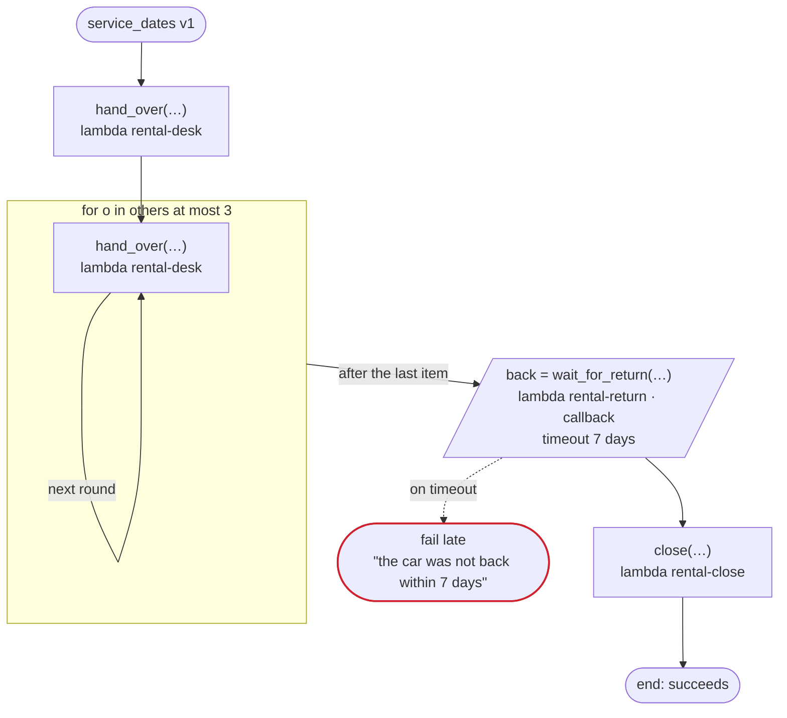

# service_dates v1

Rent a car through a service that holds its days as google.type.Date: the run reads the days of the rental and of the drivers' licences as dates, hands them to the desk, and waits for the desk to answer with the day the car came back

`tests/flows/service_dates.flow`, drawn by `dandori doc`. Inputs: `car: string`, `pickup: date`, `dropoff: date`, `closed: list[date]`, `driver: Driver`, `others: list[Driver]`. It implements `rentals.v1.RentalService` (`protos/rentals.proto`).

## flow

A rectangle is a task, one with a line down each side a rule, a slanted one a task whose value comes from outside (an event, or the answer to a callback), a hexagon a `match`, a rounded box a wait, and a box around steps a loop. A dashed arrow is an error the call handles.

## Service

What each method of the service does to a run.

| Method | What it does | Task |
|---|---|---|
| `Rent` | starts a run; it can fail with `late` | — |
| `AnswerReturn` | answers the callback | `wait_for_return` |

## Calls

| Line | Call | Calls | Retries | Timeout | When it fails |
|---:|---|---|---|---|---|
| 43 | `hand_over(…)` | `lambda rental-desk`, `idempotent` | — | — | `timeout`, `failure` → the workflow fails |
| 45 | `hand_over(…)` | `lambda rental-desk`, `idempotent` | — | — | `timeout`, `failure` → the workflow fails |
| 46 | `back = wait_for_return(…)` | `lambda rental-return · callback` | — | 1 minute to hand the id on, then 7 days | `timeout` → line 47 `failure` → the workflow fails |
| 48 | `close(…)` | `lambda rental-close`, `idempotent` | — | — | `timeout`, `failure` → the workflow fails |

## Ends

Every way the workflow can end.

| Line | End |
|---:|---|
| 47 | `fail late` "the car was not back within 7 days" |
| 48 | the flow runs to its end, and the workflow succeeds |

