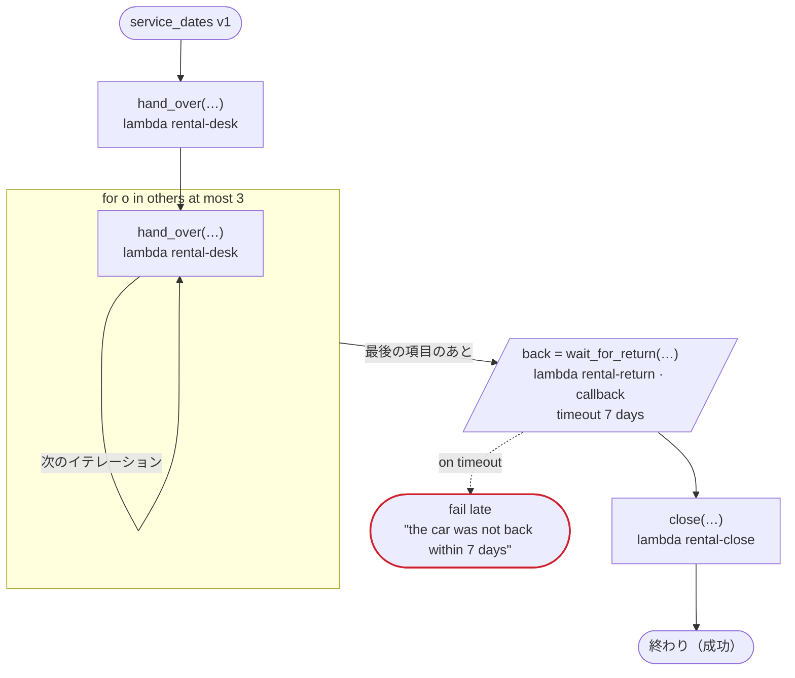

# service_dates v1

Rent a car through a service that holds its days as google.type.Date: the run reads the days of the rental and of the drivers' licences as dates, hands them to the desk, and waits for the desk to answer with the day the car came back

`tests/flows/service_dates.flow` を `dandori doc` で描いたものです。入力は `car: string`・`pickup: date`・`dropoff: date`・`closed: list[date]`・`driver: Driver`・`others: list[Driver]` です。このワークフローは `rentals.v1.RentalService`（`protos/rentals.proto`）を実装します。

## flow

四角はタスク、両脇に線のある四角は規則、斜めの四角は外から値が届くタスク（イベントやコールバックの応答）、六角形は `match`、角の丸い四角は待ち、ステップを囲む枠はループです。破線の矢印は、呼び出しがその場で処理するエラーです。

## サービス

サービスのメソッドと、それぞれが実行に対して何をするかです。

| メソッド | 何をするか | タスク |
|---|---|---|
| `Rent` | 実行を始めます。失敗の名前は `late` です | — |
| `AnswerReturn` | コールバックに応答します | `wait_for_return` |

## 呼び出し

| 行 | 呼び出し | 呼ぶもの | リトライ | タイムアウト | 失敗したとき |
|---:|---|---|---|---|---|
| 43 | `hand_over(…)` | `lambda rental-desk`・`idempotent` | — | — | `timeout`・`failure` → ワークフローが失敗する |
| 45 | `hand_over(…)` | `lambda rental-desk`・`idempotent` | — | — | `timeout`・`failure` → ワークフローが失敗する |
| 46 | `back = wait_for_return(…)` | `lambda rental-return · callback` | — | ID を渡すのに 1 分、そのあと 7 日 | `timeout` → 47 行目 `failure` → ワークフローが失敗する |
| 48 | `close(…)` | `lambda rental-close`・`idempotent` | — | — | `timeout`・`failure` → ワークフローが失敗する |

## 終わり方

ワークフローの終わり方のすべてです。

| 行 | 終わり方 |
|---:|---|
| 47 | `fail late` "the car was not back within 7 days" |
| 48 | flow が最後まで走り、ワークフローは成功する |

