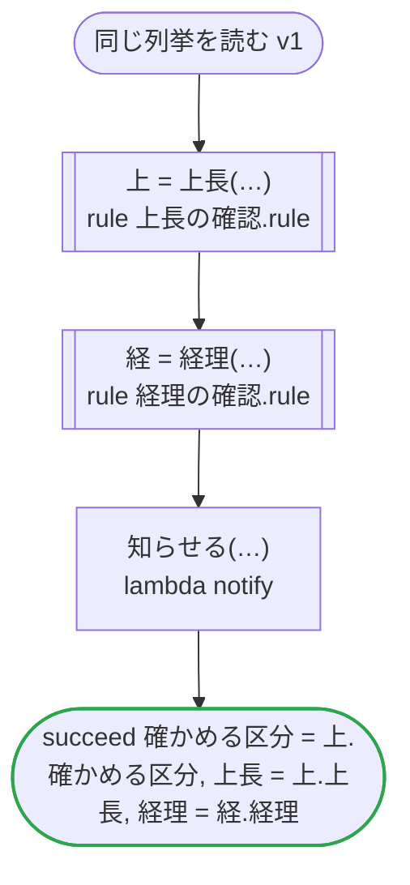

# 同じ列挙を読む v1

enums のファイルの一つの列挙を、四つの名前で読む。自分の import enum、規則として読んだ enums のファイル、呼ぶ二つの規則（どちらも同じ列挙を import enum で読む）。四つは一つの型なので、一つの名前の値を、ほかの名前が要るところに渡せる。どの出力先でも走る。shared_enums.flow の日本語の版

`tests/flows/shared_enums.ja.flow`, drawn by `dandori doc`. Inputs: `申請: 申請`. Outputs: `確かめる区分: 区分`, `上長: bool`, `経理: bool`.

## flow

A rectangle is a task, one with a line down each side a rule, a slanted one a task whose value comes from outside (an event, or the answer to a callback), a hexagon a `match`, a rounded box a wait, and a box around steps a loop. A dashed arrow is an error the call handles.

## Calls

| Line | Call | Calls | Retries | Timeout | When it fails |
|---:|---|---|---|---|---|
| 28 | `上 = 上長(…)` | rule `上長の確認.rule` | 2 times, after 1 second and 2 (failure, timeout) | 10 seconds | `timeout`, `failure` → the workflow fails |
| 30 | `経 = 経理(…)` | rule `経理の確認.rule` | 2 times, after 1 second and 2 (failure, timeout) | 10 seconds | `timeout`, `failure` → the workflow fails |
| 32 | `知らせる(…)` | `lambda notify` | — | — | `timeout`, `failure` → the workflow fails |

## Ends

Every way the workflow can end.

| Line | End |
|---:|---|
| 33 | `succeed 確かめる区分 = 上.確かめる区分, 上長 = 上.上長, 経理 = 経.経理` |

## Enums read from other files

The enums `import enum` reads from `enums` files. Their values are the file's, used as an enum written in the flow is; when the file adds a value or renames one, `dandori check` reads it again.

| Enum | Values | File | Name there | Ordered |
|---|---|---|---|---|
| `区分` | `旅費`, `購入`, `研修` | `rules/経費の区分.rule` | `区分` | no |

## Names of one enum

Each row is one enum, which the flow and the rules it uses read by these names: the same enum of one file. They are one type, so a value of one name is given where another is expected.

| Names | Declared in | Name there | Values |
|---|---|---|---|
| `区分表.区分`, `上長.区分`, `経理.区分`, `区分` | `rules/経費の区分.rule` | `区分` | `旅費`, `購入`, `研修` |

## Rules

The rules this workflow calls, each as the page for people that `rulec doc` renders.

<code>区分表</code> · 経費の区分 v1 · <code>rules/経費の区分.rule</code>

<!-- Generated by rulec 0.56.0 from 経費の区分.rule (sha256:4b9f3eda9e3b). This is a read-only rendering; the source of truth is the .rule file. Edits cannot be carried back. -->
# Enums 経費の区分 v1

経費の申請の区分。shared_enums.ja.flow と、そこから呼ぶ二つの規則が、それぞれ import enum で読む

This file holds enums and nothing else. A rule reads one with `import enum <enum> from "経費の区分.rule"`, and writes none of its values, its order or its display names again.

## Types

An enum is a **closed** finite set. Add a value, and every table that does not look at it fails the completeness check.

- **区分** (3 values) — 旅費, 購入, 研修

<code>上長</code> · 上長の確認 v1 · <code>rules/上長の確認.rule</code>

<!-- Generated by rulec 0.56.0 from 上長の確認.rule (sha256:11a439634452). This is a read-only rendering; the source of truth is the .rule file. Edits cannot be carried back. -->
# Rule 上長の確認 v1

申請を上長が確かめるかと、確かめるときの区分。研修は購入として確かめる。区分は 経費の区分.rule から読む

## Inputs

| Name | Type | Range | Notes |
|---|---|---|---|
| 区分 | 区分 (3 values) |  |  |

## Outputs

| Name | Type | Rounding | Notes |
|---|---|---|---|
| 上長 | bool |  |  |
| 確かめる区分 | 区分 (3 values) |  |  |

## Types

An enum is a **closed** finite set. Add a value, and every table that does not look at it fails the completeness check.

- **区分** (3 values) — 旅費, 購入, 研修
  - This enum is read from `経費の区分.rule`. That file keeps its values, order and display names, and `rulec check` reads it every time.

## Table 選ぶ (policy unique)

| Column | Source |
|---|---|
| 区分 | Input |
| → 上長 | Output of this rule |
| → 確かめる区分 | Output of this rule |

| # | 区分 | → 上長 (bool) | → 確かめる区分 (区分) |
|---|---|---|---|
| 1 | 旅費 | false | 旅費 |
| 2 | 購入 | true | 購入 |
| 3 | 研修 | true | 購入 |

**What `rulec check` verified**

- Every combination of inputs matches some row (E101 completeness)
- There is no row that can never match (E102 unreachable row)
- No input matches two or more rows at once (E105 overlap). Reordering the rows does not change the meaning

## Examples (verified)

| 区分 | → 上長 | → 確かめる区分 |
|---|---|---|
| 旅費 | false | 旅費 |
| 研修 | true | 購入 |

`rulec check` ran these 2 examples through the reference evaluator, and every one produced the declared values (E107). The examples are an **executable specification**.

<code>経理</code> · 経理の確認 v1 · <code>rules/経理の確認.rule</code>

<!-- Generated by rulec 0.56.0 from 経理の確認.rule (sha256:b59fa2897fa7). This is a read-only rendering; the source of truth is the .rule file. Edits cannot be carried back. -->
# Rule 経理の確認 v1

その区分の申請を経理が確かめるか。区分は 経費の区分.rule から読む

## Inputs

| Name | Type | Range | Notes |
|---|---|---|---|
| 区分 | 区分 (3 values) |  |  |

## Outputs

| Name | Type | Rounding | Notes |
|---|---|---|---|
| 経理 | bool |  |  |

## Types

An enum is a **closed** finite set. Add a value, and every table that does not look at it fails the completeness check.

- **区分** (3 values) — 旅費, 購入, 研修
  - This enum is read from `経費の区分.rule`. That file keeps its values, order and display names, and `rulec check` reads it every time.

## Table 選ぶ (policy unique)

| Column | Source |
|---|---|
| 区分 | Input |
| → 経理 | Output of this rule |

| # | 区分 | → 経理 (bool) |
|---|---|---|
| 1 | 旅費 | false |
| 2 | 購入 | true |
| 3 | 研修 | false |

**What `rulec check` verified**

- Every combination of inputs matches some row (E101 completeness)
- There is no row that can never match (E102 unreachable row)
- No input matches two or more rows at once (E105 overlap). Reordering the rows does not change the meaning

## Examples (verified)

| 区分 | → 経理 |
|---|---|
| 購入 | true |

`rulec check` ran these 1 examples through the reference evaluator, and every one produced the declared values (E107). The examples are an **executable specification**.

