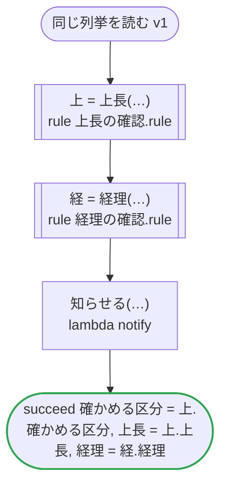

# 同じ列挙を読む v1

enums のファイルの一つの列挙を、四つの名前で読む。自分の import enum、規則として読んだ enums のファイル、呼ぶ二つの規則（どちらも同じ列挙を import enum で読む）。四つは一つの型なので、一つの名前の値を、ほかの名前が要るところに渡せる。どの出力先でも走る。shared_enums.flow の日本語の版

`tests/flows/shared_enums.ja.flow` を `dandori doc` で描いたものです。入力は `申請: 申請`、出力は `確かめる区分: 区分`・`上長: bool`・`経理: bool` です。

## flow

四角はタスク、両脇に線のある四角は規則、斜めの四角は外から値が届くタスク（イベントやコールバックの応答）、六角形は `match`、角の丸い四角は待ち、ステップを囲む枠はループです。破線の矢印は、呼び出しがその場で処理するエラーです。

## 呼び出し

| 行 | 呼び出し | 呼ぶもの | リトライ | タイムアウト | 失敗したとき |
|---:|---|---|---|---|---|
| 28 | `上 = 上長(…)` | 規則 `上長の確認.rule` | 1 秒後と 2 秒後の 2 回（failure・timeout） | 10 秒 | `timeout`・`failure` → ワークフローが失敗する |
| 30 | `経 = 経理(…)` | 規則 `経理の確認.rule` | 1 秒後と 2 秒後の 2 回（failure・timeout） | 10 秒 | `timeout`・`failure` → ワークフローが失敗する |
| 32 | `知らせる(…)` | `lambda notify` | — | — | `timeout`・`failure` → ワークフローが失敗する |

## 終わり方

ワークフローの終わり方のすべてです。

| 行 | 終わり方 |
|---:|---|
| 33 | `succeed 確かめる区分 = 上.確かめる区分, 上長 = 上.上長, 経理 = 経.経理` |

## ほかのファイルから読んだ列挙

`import enum` で、`enums` ファイルから読んだ列挙です。値は、そのファイルの列挙が持つものを、flow に書いた列挙と同じに使います。そのファイルで値を足したり名前を変えたりすると、`dandori check` はそれを読み直します。

| 列挙 | 値 | ファイル | そこでの名前 | 順 |
|---|---|---|---|---|
| `区分` | `旅費`・`購入`・`研修` | `rules/経費の区分.rule` | `区分` | なし |

## 一つの列挙の名前

一行が一つの列挙です。同じファイルの同じ列挙を、フローと、フローが使う規則が、これらの名前で読んでいます。一つの型なので、一つの名前の値を、ほかの名前が要るところに渡せます。

| 名前 | 宣言しているファイル | そこでの名前 | 値 |
|---|---|---|---|
| `区分表.区分`・`上長.区分`・`経理.区分`・`区分` | `rules/経費の区分.rule` | `区分` | `旅費`・`購入`・`研修` |

## 規則

このワークフローが呼ぶ規則です。`rulec doc` が描いた、人が読むページをそのまま載せています。

<code>区分表</code> · 経費の区分 v1 · <code>rules/経費の区分.rule</code>

<!-- rulec 0.55.2 が 経費の区分.rule (sha256:4b9f3eda9e3b) から生成した資料です。読むためのもので、もとになるのは .rule のほうです。ここを編集しても .rule には戻せません。 -->
# 列挙 経費の区分 v1

経費の申請の区分。shared_enums.ja.flow と、そこから呼ぶ二つの規則が、それぞれ import enum で読む

このファイルは列挙だけを持ちます。規則は `import enum <列挙> from "経費の区分.rule"` で読み、値も順序も表示名も書き直しません。

## 型

列挙は**閉じた**有限集合です。値を足すと、その値を扱っていない表は完全性の検査を通らなくなります。

- **区分**（3 値）— 旅費、購入、研修

<code>上長</code> · 上長の確認 v1 · <code>rules/上長の確認.rule</code>

<!-- rulec 0.55.2 が 上長の確認.rule (sha256:11a439634452) から生成した資料です。読むためのもので、もとになるのは .rule のほうです。ここを編集しても .rule には戻せません。 -->
# 規則 上長の確認 v1

申請を上長が確かめるかと、確かめるときの区分。研修は購入として確かめる。区分は 経費の区分.rule から読む

## 入力

| 名前 | 型 | 範囲 | 注記 |
|---|---|---|---|
| 区分 | 区分（3 値） |  |  |

## 出力

| 名前 | 型 | 丸め | 注記 |
|---|---|---|---|
| 上長 | bool |  |  |
| 確かめる区分 | 区分（3 値） |  |  |

## 型

列挙は**閉じた**有限集合です。値を足すと、その値を扱っていない表は完全性の検査を通らなくなります。

- **区分**（3 値）— 旅費、購入、研修
  - この列挙は `経費の区分.rule` から読みます。値・順序・表示名はそのファイルが持ち、`rulec check` は毎回そのファイルを読みます。

## 表 選ぶ（policy unique）

| 列 | 出どころ |
|---|---|
| 区分 | 入力 |
| → 上長 | この規則の出力 |
| → 確かめる区分 | この規則の出力 |

| # | 区分 | → 上長（bool） | → 確かめる区分（区分） |
|---|---|---|---|
| 1 | 旅費 | false | 旅費 |
| 2 | 購入 | true | 購入 |
| 3 | 研修 | true | 購入 |

**`rulec check` が確かめたこと**

- どの入力の組合せも、いずれかの行に当てはまります（E101 完全性）
- どの入力にも当てはまらない行はありません（E102）
- 二つ以上の行に同時に当てはまる入力はありません（E105 重なり）。行の並べ替えは意味を変えません

## 例（検証済み）

| 区分 | → 上長 | → 確かめる区分 |
|---|---|---|
| 旅費 | false | 旅費 |
| 研修 | true | 購入 |

この 2 件は `rulec check` が参照評価器で実行し、すべて宣言どおりの値になりました（E107）。例は**実行される仕様**です。

<code>経理</code> · 経理の確認 v1 · <code>rules/経理の確認.rule</code>

<!-- rulec 0.55.2 が 経理の確認.rule (sha256:b59fa2897fa7) から生成した資料です。読むためのもので、もとになるのは .rule のほうです。ここを編集しても .rule には戻せません。 -->
# 規則 経理の確認 v1

その区分の申請を経理が確かめるか。区分は 経費の区分.rule から読む

## 入力

| 名前 | 型 | 範囲 | 注記 |
|---|---|---|---|
| 区分 | 区分（3 値） |  |  |

## 出力

| 名前 | 型 | 丸め | 注記 |
|---|---|---|---|
| 経理 | bool |  |  |

## 型

列挙は**閉じた**有限集合です。値を足すと、その値を扱っていない表は完全性の検査を通らなくなります。

- **区分**（3 値）— 旅費、購入、研修
  - この列挙は `経費の区分.rule` から読みます。値・順序・表示名はそのファイルが持ち、`rulec check` は毎回そのファイルを読みます。

## 表 選ぶ（policy unique）

| 列 | 出どころ |
|---|---|
| 区分 | 入力 |
| → 経理 | この規則の出力 |

| # | 区分 | → 経理（bool） |
|---|---|---|
| 1 | 旅費 | false |
| 2 | 購入 | true |
| 3 | 研修 | false |

**`rulec check` が確かめたこと**

- どの入力の組合せも、いずれかの行に当てはまります（E101 完全性）
- どの入力にも当てはまらない行はありません（E102）
- 二つ以上の行に同時に当てはまる入力はありません（E105 重なり）。行の並べ替えは意味を変えません

## 例（検証済み）

| 区分 | → 経理 |
|---|---|
| 購入 | true |

この 1 件は `rulec check` が参照評価器で実行し、すべて宣言どおりの値になりました（E107）。例は**実行される仕様**です。

