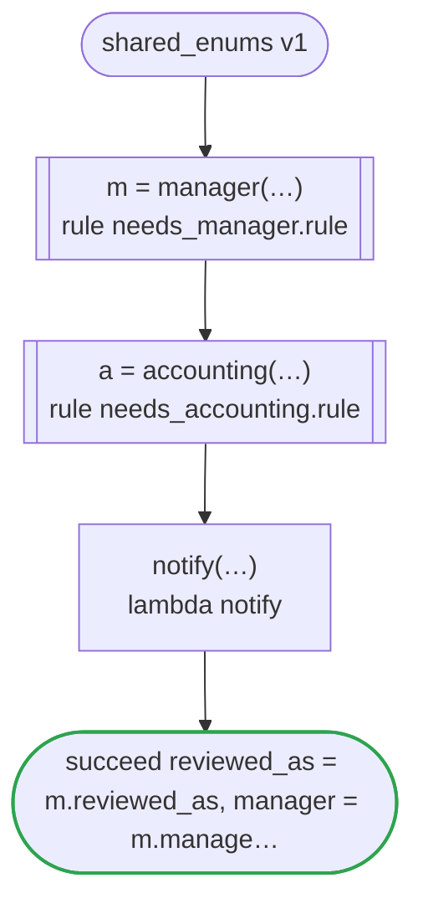

# shared_enums v1

Reads one enum of an enums file by four names: its own import enum, the enums file used as a rule, and the two rules it calls, which import the enum too. The four are one type, so a value of one is given where another is expected. Runs on every platform

`tests/flows/shared_enums.flow`, drawn by `dandori doc`. Inputs: `claim: Claim`. Outputs: `reviewed_as: category`, `manager: bool`, `accounting: bool`.

## flow

A rectangle is a task, one with a line down each side a rule, a slanted one a task whose value comes from outside (an event, or the answer to a callback), a hexagon a `match`, a rounded box a wait, and a box around steps a loop. A dashed arrow is an error the call handles.

## Calls

| Line | Call | Calls | Retries | Timeout | When it fails |
|---:|---|---|---|---|---|
| 28 | `m = manager(…)` | rule `needs_manager.rule` | 2 times, after 1 second and 2 (failure, timeout) | 10 seconds | `timeout`, `failure` → the workflow fails |
| 30 | `a = accounting(…)` | rule `needs_accounting.rule` | 2 times, after 1 second and 2 (failure, timeout) | 10 seconds | `timeout`, `failure` → the workflow fails |
| 32 | `notify(…)` | `lambda notify` | — | — | `timeout`, `failure` → the workflow fails |

## Ends

Every way the workflow can end.

| Line | End |
|---:|---|
| 33 | `succeed reviewed_as = m.reviewed_as, manager = m.manager, accounting = a.accounting` |

## Enums read from other files

The enums `import enum` reads from `enums` files. Their values are the file's, used as an enum written in the flow is; when the file adds a value or renames one, `dandori check` reads it again.

| Enum | Values | File | Name there | Ordered |
|---|---|---|---|---|
| `category` | `travel`, `purchase`, `training` | `rules/expense_categories.rule` | `category` | no |

## Names of one enum

Each row is one enum, which the flow and the rules it uses read by these names: the same enum of one file. They are one type, so a value of one name is given where another is expected.

| Names | Declared in | Name there | Values |
|---|---|---|---|
| `categories.category`, `manager.category`, `accounting.category`, `category` | `rules/expense_categories.rule` | `category` | `travel`, `purchase`, `training` |

## Rules

The rules this workflow calls, each as the page for people that `rulec doc` renders.

<code>categories</code> · expense_categories v1 · <code>rules/expense_categories.rule</code>

<!-- Generated by rulec 0.55.2 from expense_categories.rule (sha256:2294d536388a). This is a read-only rendering; the source of truth is the .rule file. Edits cannot be carried back. -->
# Enums expense_categories v1

The categories of an expense claim, read by shared_enums.flow and by the two rules it calls, each with import enum

This file holds enums and nothing else. A rule reads one with `import enum <enum> from "expense_categories.rule"`, and writes none of its values, its order or its display names again.

## Types

An enum is a **closed** finite set. Add a value, and every table that does not look at it fails the completeness check.

- **category** (3 values) — travel, purchase, training

<code>manager</code> · needs_manager v1 · <code>rules/needs_manager.rule</code>

<!-- Generated by rulec 0.55.2 from needs_manager.rule (sha256:30b27a432b0b). This is a read-only rendering; the source of truth is the .rule file. Edits cannot be carried back. -->
# Rule needs_manager v1

Whether a manager reviews a claim, and the category it is reviewed as: training is reviewed as a purchase. Reads its category from expense_categories.rule

## Inputs

| Name | Type | Range | Notes |
|---|---|---|---|
| category | category (3 values) |  |  |

## Outputs

| Name | Type | Rounding | Notes |
|---|---|---|---|
| manager | bool |  |  |
| reviewed_as | category (3 values) |  |  |

## Types

An enum is a **closed** finite set. Add a value, and every table that does not look at it fails the completeness check.

- **category** (3 values) — travel, purchase, training
  - This enum is read from `expense_categories.rule`. That file keeps its values, order and display names, and `rulec check` reads it every time.

## Table pick (policy unique)

| Column | Source |
|---|---|
| category | Input |
| → manager | Output of this rule |
| → reviewed_as | Output of this rule |

| # | category | → manager (bool) | → reviewed_as (category) |
|---|---|---|---|
| 1 | travel | false | travel |
| 2 | purchase | true | purchase |
| 3 | training | true | purchase |

**What `rulec check` verified**

- Every combination of inputs matches some row (E101 completeness)
- There is no row that can never match (E102 unreachable row)
- No input matches two or more rows at once (E105 overlap). Reordering the rows does not change the meaning

## Examples (verified)

| category | → manager | → reviewed_as |
|---|---|---|
| travel | false | travel |
| training | true | purchase |

`rulec check` ran these 2 examples through the reference evaluator, and every one produced the declared values (E107). The examples are an **executable specification**.

<code>accounting</code> · needs_accounting v1 · <code>rules/needs_accounting.rule</code>

<!-- Generated by rulec 0.55.2 from needs_accounting.rule (sha256:99c4cb5f5f21). This is a read-only rendering; the source of truth is the .rule file. Edits cannot be carried back. -->
# Rule needs_accounting v1

Whether accounting checks a claim of a category. Reads its category from expense_categories.rule

## Inputs

| Name | Type | Range | Notes |
|---|---|---|---|
| category | category (3 values) |  |  |

## Outputs

| Name | Type | Rounding | Notes |
|---|---|---|---|
| accounting | bool |  |  |

## Types

An enum is a **closed** finite set. Add a value, and every table that does not look at it fails the completeness check.

- **category** (3 values) — travel, purchase, training
  - This enum is read from `expense_categories.rule`. That file keeps its values, order and display names, and `rulec check` reads it every time.

## Table pick (policy unique)

| Column | Source |
|---|---|
| category | Input |
| → accounting | Output of this rule |

| # | category | → accounting (bool) |
|---|---|---|
| 1 | travel | false |
| 2 | purchase | true |
| 3 | training | false |

**What `rulec check` verified**

- Every combination of inputs matches some row (E101 completeness)
- There is no row that can never match (E102 unreachable row)
- No input matches two or more rows at once (E105 overlap). Reordering the rows does not change the meaning

## Examples (verified)

| category | → accounting |
|---|---|
| purchase | true |

`rulec check` ran these 1 examples through the reference evaluator, and every one produced the declared values (E107). The examples are an **executable specification**.

