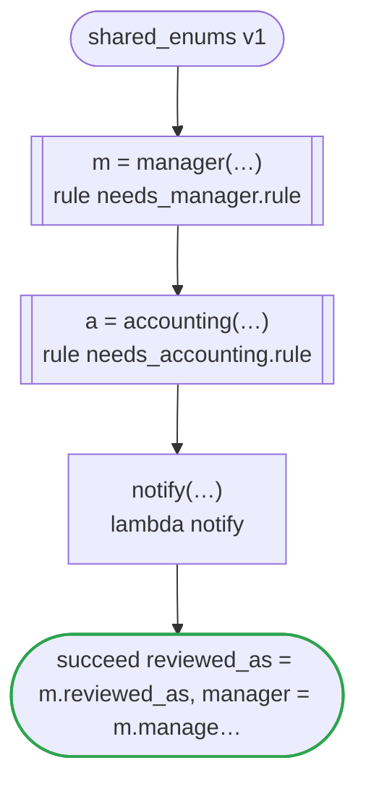

# shared_enums v1

Reads one enum of an enums file by four names: its own import enum, the enums file used as a rule, and the two rules it calls, which import the enum too. The four are one type, so a value of one is given where another is expected. Runs on every platform

`tests/flows/shared_enums.flow` を `dandori doc` で描いたものです。入力は `claim: Claim`、出力は `reviewed_as: category`・`manager: bool`・`accounting: bool` です。

## flow

四角はタスク、両脇に線のある四角は規則、斜めの四角は外から値が届くタスク（イベントやコールバックの応答）、六角形は `match`、角の丸い四角は待ち、ステップを囲む枠はループです。破線の矢印は、呼び出しがその場で処理するエラーです。

## 呼び出し

| 行 | 呼び出し | 呼ぶもの | リトライ | タイムアウト | 失敗したとき |
|---:|---|---|---|---|---|
| 28 | `m = manager(…)` | 規則 `needs_manager.rule` | 1 秒後と 2 秒後の 2 回（failure・timeout） | 10 秒 | `timeout`・`failure` → ワークフローが失敗する |
| 30 | `a = accounting(…)` | 規則 `needs_accounting.rule` | 1 秒後と 2 秒後の 2 回（failure・timeout） | 10 秒 | `timeout`・`failure` → ワークフローが失敗する |
| 32 | `notify(…)` | `lambda notify` | — | — | `timeout`・`failure` → ワークフローが失敗する |

## 終わり方

ワークフローの終わり方のすべてです。

| 行 | 終わり方 |
|---:|---|
| 33 | `succeed reviewed_as = m.reviewed_as, manager = m.manager, accounting = a.accounting` |

## ほかのファイルから読んだ列挙

`import enum` で、`enums` ファイルから読んだ列挙です。値は、そのファイルの列挙が持つものを、flow に書いた列挙と同じに使います。そのファイルで値を足したり名前を変えたりすると、`dandori check` はそれを読み直します。

| 列挙 | 値 | ファイル | そこでの名前 | 順 |
|---|---|---|---|---|
| `category` | `travel`・`purchase`・`training` | `rules/expense_categories.rule` | `category` | なし |

## 一つの列挙の名前

一行が一つの列挙です。同じファイルの同じ列挙を、フローと、フローが使う規則が、これらの名前で読んでいます。一つの型なので、一つの名前の値を、ほかの名前が要るところに渡せます。

| 名前 | 宣言しているファイル | そこでの名前 | 値 |
|---|---|---|---|
| `categories.category`・`manager.category`・`accounting.category`・`category` | `rules/expense_categories.rule` | `category` | `travel`・`purchase`・`training` |

## 規則

このワークフローが呼ぶ規則です。`rulec doc` が描いた、人が読むページをそのまま載せています。

<code>categories</code> · expense_categories v1 · <code>rules/expense_categories.rule</code>

<!-- rulec 0.55.2 が expense_categories.rule (sha256:2294d536388a) から生成した資料です。読むためのもので、もとになるのは .rule のほうです。ここを編集しても .rule には戻せません。 -->
# 列挙 expense_categories v1

The categories of an expense claim, read by shared_enums.flow and by the two rules it calls, each with import enum

このファイルは列挙だけを持ちます。規則は `import enum <列挙> from "expense_categories.rule"` で読み、値も順序も表示名も書き直しません。

## 型

列挙は**閉じた**有限集合です。値を足すと、その値を扱っていない表は完全性の検査を通らなくなります。

- **category**（3 値）— travel、purchase、training

<code>manager</code> · needs_manager v1 · <code>rules/needs_manager.rule</code>

<!-- rulec 0.55.2 が needs_manager.rule (sha256:30b27a432b0b) から生成した資料です。読むためのもので、もとになるのは .rule のほうです。ここを編集しても .rule には戻せません。 -->
# 規則 needs_manager v1

Whether a manager reviews a claim, and the category it is reviewed as: training is reviewed as a purchase. Reads its category from expense_categories.rule

## 入力

| 名前 | 型 | 範囲 | 注記 |
|---|---|---|---|
| category | category（3 値） |  |  |

## 出力

| 名前 | 型 | 丸め | 注記 |
|---|---|---|---|
| manager | bool |  |  |
| reviewed_as | category（3 値） |  |  |

## 型

列挙は**閉じた**有限集合です。値を足すと、その値を扱っていない表は完全性の検査を通らなくなります。

- **category**（3 値）— travel、purchase、training
  - この列挙は `expense_categories.rule` から読みます。値・順序・表示名はそのファイルが持ち、`rulec check` は毎回そのファイルを読みます。

## 表 pick（policy unique）

| 列 | 出どころ |
|---|---|
| category | 入力 |
| → manager | この規則の出力 |
| → reviewed_as | この規則の出力 |

| # | category | → manager（bool） | → reviewed_as（category） |
|---|---|---|---|
| 1 | travel | false | travel |
| 2 | purchase | true | purchase |
| 3 | training | true | purchase |

**`rulec check` が確かめたこと**

- どの入力の組合せも、いずれかの行に当てはまります（E101 完全性）
- どの入力にも当てはまらない行はありません（E102）
- 二つ以上の行に同時に当てはまる入力はありません（E105 重なり）。行の並べ替えは意味を変えません

## 例（検証済み）

| category | → manager | → reviewed_as |
|---|---|---|
| travel | false | travel |
| training | true | purchase |

この 2 件は `rulec check` が参照評価器で実行し、すべて宣言どおりの値になりました（E107）。例は**実行される仕様**です。

<code>accounting</code> · needs_accounting v1 · <code>rules/needs_accounting.rule</code>

<!-- rulec 0.55.2 が needs_accounting.rule (sha256:99c4cb5f5f21) から生成した資料です。読むためのもので、もとになるのは .rule のほうです。ここを編集しても .rule には戻せません。 -->
# 規則 needs_accounting v1

Whether accounting checks a claim of a category. Reads its category from expense_categories.rule

## 入力

| 名前 | 型 | 範囲 | 注記 |
|---|---|---|---|
| category | category（3 値） |  |  |

## 出力

| 名前 | 型 | 丸め | 注記 |
|---|---|---|---|
| accounting | bool |  |  |

## 型

列挙は**閉じた**有限集合です。値を足すと、その値を扱っていない表は完全性の検査を通らなくなります。

- **category**（3 値）— travel、purchase、training
  - この列挙は `expense_categories.rule` から読みます。値・順序・表示名はそのファイルが持ち、`rulec check` は毎回そのファイルを読みます。

## 表 pick（policy unique）

| 列 | 出どころ |
|---|---|
| category | 入力 |
| → accounting | この規則の出力 |

| # | category | → accounting（bool） |
|---|---|---|
| 1 | travel | false |
| 2 | purchase | true |
| 3 | training | false |

**`rulec check` が確かめたこと**

- どの入力の組合せも、いずれかの行に当てはまります（E101 完全性）
- どの入力にも当てはまらない行はありません（E102）
- 二つ以上の行に同時に当てはまる入力はありません（E105 重なり）。行の並べ替えは意味を変えません

## 例（検証済み）

| category | → accounting |
|---|---|
| purchase | true |

この 1 件は `rulec check` が参照評価器で実行し、すべて宣言どおりの値になりました（E107）。例は**実行される仕様**です。

