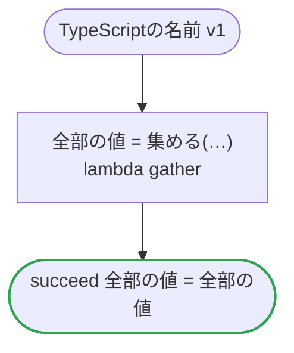

# TypeScriptの名前 v1

TypeScript のグローバルな型の名前を、型に付けたフローです。types.ts が読む型（そのときは globalThis から読みます）と、コードのどのファイルも読まない型を使います。フローはどのプラットフォームでも動きます

`tests/flows/ts_names.ja.flow`, drawn by `dandori doc`. Inputs: `番号: string`. Outputs: `全部の値: 全部`.

## flow

A rectangle is a task, one with a line down each side a rule, a slanted one a task whose value comes from outside (an event, or the answer to a callback), a hexagon a `match`, a rounded box a wait, and a box around steps a loop. A dashed arrow is an error the call handles.

## Calls

| Line | Call | Calls | Retries | Timeout | When it fails |
|---:|---|---|---|---|---|
| 59 | `全部の値 = 集める(…)` | `lambda gather`, `idempotent` | — | — | `timeout`, `failure` → the workflow fails |

## Ends

Every way the workflow can end.

| Line | End |
|---:|---|
| 60 | `succeed 全部の値 = 全部の値` |

