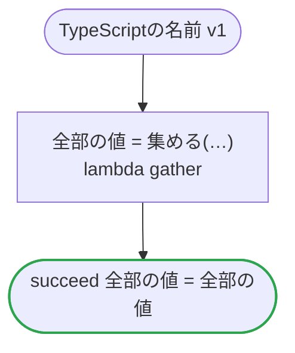

# TypeScriptの名前 v1

TypeScript のグローバルな型の名前を、型に付けたフローです。types.ts が読む型（そのときは globalThis から読みます）と、コードのどのファイルも読まない型を使います。フローはどのプラットフォームでも動きます

`tests/flows/ts_names.ja.flow` を `dandori doc` で描いたものです。入力は `番号: string`、出力は `全部の値: 全部` です。

## flow

四角はタスク、両脇に線のある四角は規則、斜めの四角は外から値が届くタスク（イベントやコールバックの応答）、六角形は `match`、角の丸い四角は待ち、ステップを囲む枠はループです。破線の矢印は、呼び出しがその場で処理するエラーです。

## 呼び出し

| 行 | 呼び出し | 呼ぶもの | リトライ | タイムアウト | 失敗したとき |
|---:|---|---|---|---|---|
| 59 | `全部の値 = 集める(…)` | `lambda gather`・`idempotent` | — | — | `timeout`・`failure` → ワークフローが失敗する |

## 終わり方

ワークフローの終わり方のすべてです。

| 行 | 終わり方 |
|---:|---|
| 60 | `succeed 全部の値 = 全部の値` |

