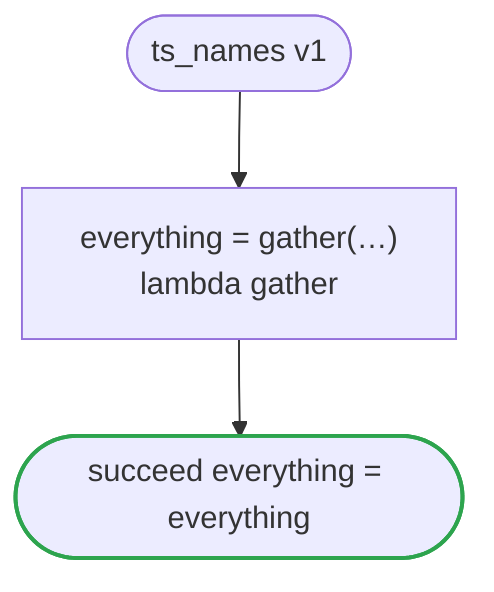

# ts_names v1

Types named as the global types of TypeScript: the ones types.ts reads, which it then reads through globalThis, and the ones no file of the code reads. The flow runs on every platform

`tests/flows/ts_names.flow`, drawn by `dandori doc`. Inputs: `id: string`. Outputs: `everything: Everything`.

## flow

A rectangle is a task, one with a line down each side a rule, a slanted one a task whose value comes from outside (an event, or the answer to a callback), a hexagon a `match`, a rounded box a wait, and a box around steps a loop. A dashed arrow is an error the call handles.

## Calls

| Line | Call | Calls | Retries | Timeout | When it fails |
|---:|---|---|---|---|---|
| 59 | `everything = gather(…)` | `lambda gather`, `idempotent` | — | — | `timeout`, `failure` → the workflow fails |

## Ends

Every way the workflow can end.

| Line | End |
|---:|---|
| 60 | `succeed everything = everything` |

