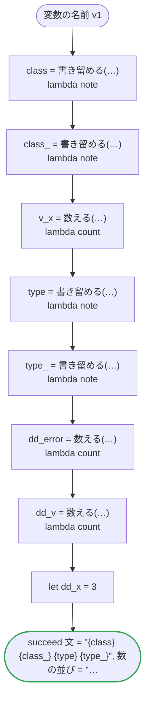

# 変数の名前 v1

出力先のコードが一つの名前に書いてしまう変数と、コードが自分で持つ名前の変数を持つフローです。class と class_、_x と v_x、type と type_、dd_ で始まる名前を使います。どの出力先のコードも別々の変数にし、フローはどのプラットフォームでも動きます

`tests/flows/variable_names.ja.flow`, drawn by `dandori doc`. Inputs: `番号: string`, `_x: int`. Outputs: `文: string`, `数の並び: string`.

## flow

A rectangle is a task, one with a line down each side a rule, a slanted one a task whose value comes from outside (an event, or the answer to a callback), a hexagon a `match`, a rounded box a wait, and a box around steps a loop. A dashed arrow is an error the call handles.

## Calls

| Line | Call | Calls | Retries | Timeout | When it fails |
|---:|---|---|---|---|---|
| 22 | `class = 書き留める(…)` | `lambda note`, `idempotent` | — | — | `timeout`, `failure` → the workflow fails |
| 23 | `class_ = 書き留める(…)` | `lambda note`, `idempotent` | — | — | `timeout`, `failure` → the workflow fails |
| 25 | `v_x = 数える(…)` | `lambda count`, `idempotent` | — | — | `timeout`, `failure` → the workflow fails |
| 27 | `type = 書き留める(…)` | `lambda note`, `idempotent` | — | — | `timeout`, `failure` → the workflow fails |
| 28 | `type_ = 書き留める(…)` | `lambda note`, `idempotent` | — | — | `timeout`, `failure` → the workflow fails |
| 30 | `dd_error = 数える(…)` | `lambda count`, `idempotent` | — | — | `timeout`, `failure` → the workflow fails |
| 31 | `dd_v = 数える(…)` | `lambda count`, `idempotent` | — | — | `timeout`, `failure` → the workflow fails |

## Ends

Every way the workflow can end.

| Line | End |
|---:|---|
| 33 | `succeed 文 = "{class} {class_} {type} {type_}", 数の並び = "{_x} {v_x} {dd_error} {dd_v} {dd_x}"` |

