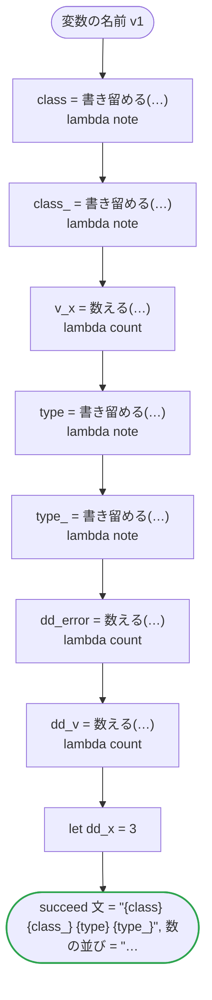

# 変数の名前 v1

出力先のコードが一つの名前に書いてしまう変数と、コードが自分で持つ名前の変数を持つフローです。class と class_、_x と v_x、type と type_、dd_ で始まる名前を使います。どの出力先のコードも別々の変数にし、フローはどのプラットフォームでも動きます

`tests/flows/variable_names.ja.flow` を `dandori doc` で描いたものです。入力は `番号: string`・`_x: int`、出力は `文: string`・`数の並び: string` です。

## flow

四角はタスク、両脇に線のある四角は規則、斜めの四角は外から値が届くタスク（イベントやコールバックの応答）、六角形は `match`、角の丸い四角は待ち、ステップを囲む枠はループです。破線の矢印は、呼び出しがその場で処理するエラーです。

## 呼び出し

| 行 | 呼び出し | 呼ぶもの | リトライ | タイムアウト | 失敗したとき |
|---:|---|---|---|---|---|
| 22 | `class = 書き留める(…)` | `lambda note`・`idempotent` | — | — | `timeout`・`failure` → ワークフローが失敗する |
| 23 | `class_ = 書き留める(…)` | `lambda note`・`idempotent` | — | — | `timeout`・`failure` → ワークフローが失敗する |
| 25 | `v_x = 数える(…)` | `lambda count`・`idempotent` | — | — | `timeout`・`failure` → ワークフローが失敗する |
| 27 | `type = 書き留める(…)` | `lambda note`・`idempotent` | — | — | `timeout`・`failure` → ワークフローが失敗する |
| 28 | `type_ = 書き留める(…)` | `lambda note`・`idempotent` | — | — | `timeout`・`failure` → ワークフローが失敗する |
| 30 | `dd_error = 数える(…)` | `lambda count`・`idempotent` | — | — | `timeout`・`failure` → ワークフローが失敗する |
| 31 | `dd_v = 数える(…)` | `lambda count`・`idempotent` | — | — | `timeout`・`failure` → ワークフローが失敗する |

## 終わり方

ワークフローの終わり方のすべてです。

| 行 | 終わり方 |
|---:|---|
| 33 | `succeed 文 = "{class} {class_} {type} {type_}", 数の並び = "{_x} {v_x} {dd_error} {dd_v} {dd_x}"` |

