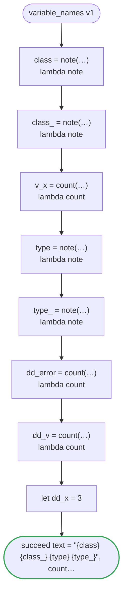

# variable_names v1

Variables that the code of a target would write as one name, and variables named as the code's own: class and class_, _x and v_x, type and type_, and names that begin with dd_. The code of each target keeps them apart, and the flow runs on every platform

`tests/flows/variable_names.flow`, drawn by `dandori doc`. Inputs: `id: string`, `_x: int`. Outputs: `text: string`, `counts: string`.

## flow

A rectangle is a task, one with a line down each side a rule, a slanted one a task whose value comes from outside (an event, or the answer to a callback), a hexagon a `match`, a rounded box a wait, and a box around steps a loop. A dashed arrow is an error the call handles.

## Calls

| Line | Call | Calls | Retries | Timeout | When it fails |
|---:|---|---|---|---|---|
| 22 | `class = note(…)` | `lambda note`, `idempotent` | — | — | `timeout`, `failure` → the workflow fails |
| 23 | `class_ = note(…)` | `lambda note`, `idempotent` | — | — | `timeout`, `failure` → the workflow fails |
| 25 | `v_x = count(…)` | `lambda count`, `idempotent` | — | — | `timeout`, `failure` → the workflow fails |
| 27 | `type = note(…)` | `lambda note`, `idempotent` | — | — | `timeout`, `failure` → the workflow fails |
| 28 | `type_ = note(…)` | `lambda note`, `idempotent` | — | — | `timeout`, `failure` → the workflow fails |
| 30 | `dd_error = count(…)` | `lambda count`, `idempotent` | — | — | `timeout`, `failure` → the workflow fails |
| 31 | `dd_v = count(…)` | `lambda count`, `idempotent` | — | — | `timeout`, `failure` → the workflow fails |

## Ends

Every way the workflow can end.

| Line | End |
|---:|---|
| 33 | `succeed text = "{class} {class_} {type} {type_}", counts = "{_x} {v_x} {dd_error} {dd_v} {dd_x}"` |

