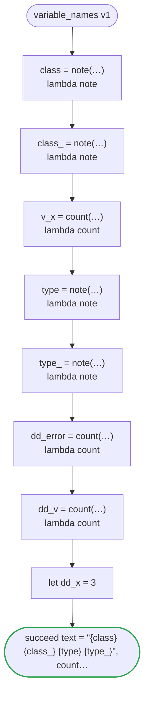

# variable_names v1

Variables that the code of a target would write as one name, and variables named as the code's own: class and class_, _x and v_x, type and type_, and names that begin with dd_. The code of each target keeps them apart, and the flow runs on every platform

`tests/flows/variable_names.flow` を `dandori doc` で描いたものです。入力は `id: string`・`_x: int`、出力は `text: string`・`counts: string` です。

## flow

四角はタスク、両脇に線のある四角は規則、斜めの四角は外から値が届くタスク（イベントやコールバックの応答）、六角形は `match`、角の丸い四角は待ち、ステップを囲む枠はループです。破線の矢印は、呼び出しがその場で処理するエラーです。

## 呼び出し

| 行 | 呼び出し | 呼ぶもの | リトライ | タイムアウト | 失敗したとき |
|---:|---|---|---|---|---|
| 22 | `class = note(…)` | `lambda note`・`idempotent` | — | — | `timeout`・`failure` → ワークフローが失敗する |
| 23 | `class_ = note(…)` | `lambda note`・`idempotent` | — | — | `timeout`・`failure` → ワークフローが失敗する |
| 25 | `v_x = count(…)` | `lambda count`・`idempotent` | — | — | `timeout`・`failure` → ワークフローが失敗する |
| 27 | `type = note(…)` | `lambda note`・`idempotent` | — | — | `timeout`・`failure` → ワークフローが失敗する |
| 28 | `type_ = note(…)` | `lambda note`・`idempotent` | — | — | `timeout`・`failure` → ワークフローが失敗する |
| 30 | `dd_error = count(…)` | `lambda count`・`idempotent` | — | — | `timeout`・`failure` → ワークフローが失敗する |
| 31 | `dd_v = count(…)` | `lambda count`・`idempotent` | — | — | `timeout`・`failure` → ワークフローが失敗する |

## 終わり方

ワークフローの終わり方のすべてです。

| 行 | 終わり方 |
|---:|---|
| 33 | `succeed text = "{class} {class_} {type} {type_}", counts = "{_x} {v_x} {dd_error} {dd_v} {dd_x}"` |

