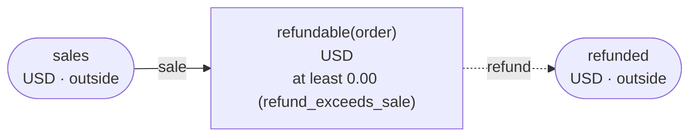

# Pages for people

`chobo doc` writes a book as a page for the people who keep the accounts and run the operations,
and for anyone who checks a book against what they know of the business: what each account is and
the bounds it keeps, how things move between the accounts, what each transfer can be refused with
and why, how a hold ends, and every scenario, with the balances after each step. Nothing on the page
is written by hand: it is the book, what the checker found, and what the reference interpreter
answered.

```console
$ chobo doc examples/refunds/refunds.book --out pages
$ chobo doc examples/refunds/refunds.book --format html --out pages
$ chobo doc examples/refunds/refunds.ja.book --format html --lang ja --out pages
```

The page is written in English, or in Japanese with `--lang ja`, as Markdown or as one HTML page.
Without `--out` it goes to standard output; with it, into the directory, named after the book's file
(`refunds.md`, `refunds.html`), so that a book and its Japanese version can sit side by side.

## The four examples, drawn

These are what `chobo doc --format html` writes for the examples, as they are now:

| Example | Its page | What to step through |
|---|---|---|
| the stock of an order, held for 30 minutes | [inventory](doc/inventory.html) | the last of a SKU, held by one of two orders at once |
| loyalty points, earned on a hold and spent on another | [points](doc/points.html) | a member's points filled to their upper bound |
| refunds that never exceed the sale | [refunds](doc/refunds.html) | two refunds after the last of a sale ([that scenario](doc/refunds.html#scenario=19&step=2&outcome=2)) |
| a marketplace that splits a sale between the shop and its fee | [marketplace](doc/marketplace.html) | a refund refused at its second move, with nothing moved |

The Japanese site draws the Japanese version of each, with `--lang ja`.

## What is on a page

- **The heading**: the book's name, version and description, and how to read the page: a balance
  is what came in less what went out, a transfer that would break a bound is refused with the
  bound's name and moves nothing, and a transfer moves at once or holds first.
- **The accounts**: one row each, with what it is split by, its unit, its bounds and the reason
  each refuses with, and its description. An account outside the book says so.
- **How things move**: the chart. A box is an account, with its unit and its bounds; an arrow a move
  of a transfer, dashed when the transfer holds first; an account outside the book has rounded
  corners. A transfer of two moves names the amount on each arrow.
- **Each transfer**: its moves, numbered when there are two or more, and made all or none; its key,
  and what a second call with other arguments gets; how a hold ends. A transfer that holds has the
  chart of a hold's life and a table of what `post` and `void` answer in each state. Then the table
  of what each operation can be refused with and when, and, folded, the operations that get to
  each reason, with the balances at the move that was refused.
- **The scenarios**: every scenario `chobo scenarios` writes, with the balances after each step,
  what is posted and, in brackets, what is held. A scenario with callers at the same time is shown
  once for each way it can come out.
- **The checker's warnings**, as `chobo check` prints them, when the book has any.

A page shows the book, not the database: TigerBeetle's extra accounts and chains and PostgreSQL's
tables are not on it. Those are for whoever runs the database, and `chobo run --show` and
[Targets](targets.md) have them.

## As Markdown

The Markdown draws its charts in Mermaid, which GitHub draws in a pull request, an issue or a
README, so a change to a book can carry its page. The chart of the refunds, from the page beside
the example
([examples/refunds/doc.md](https://github.com/i2y/ritsu/blob/main/crates/chobo/examples/refunds/doc.md)):



The life of a hold is a state diagram, and each scenario is folded under its name, as a table of
the balances after each step. Every example has its page
beside it in the repository, `doc.md` and its Japanese version `doc.ja.md`.

## As one HTML page

`--format html` writes one page that needs nothing else: chobo draws the charts itself, and the
page fetches no script, font or picture, so it opens where there is no network.

- **Pick a scenario** from the list, and step through it with the buttons, the arrow keys, or by
  pressing a step. The table under it shows the balances and holds after that step, with what
  changed lit.
- **The chart follows**: the transfers the step called are lit on it, green when they went
  through and red when they were refused.
- **A link keeps the place**: the scenario, the step and the way it came out are in the address
  (`#scenario=19&step=2&outcome=2`), so a link to a page can open on the step it is about.

The page has a light and a dark scheme, following the reader's system. On a narrow screen, the
tables, the charts and the code scroll sideways in their own boxes, and the page does not.
